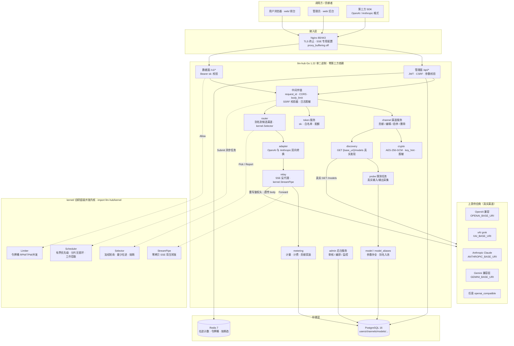
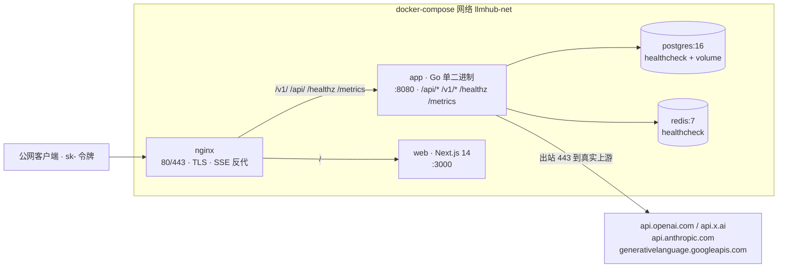

# llm-hub 通用大模型 API 聚合中转站 · 项目方案（初稿）

> | 项 | 值 |
> |---|---|
> | 文档 | `docs/01-方案初稿.md` |
> | 产出团队 | 团队 1 · 项目方案撰写 |
> | 唯一写入范围 | `docs/01-方案初稿.md`（本文件，未写任何其它路径） |
> | 基线 | `SPEC.md`（8 团队唯一共同基线）+ `LLM-API-Aggregator-Prompt.md`（F1–F14 需求源） |
> | 技术契约 | `go.mod`（`module llm-hub`，`go 1.22`，零 `require`）、`kernel/contract.go`（冻结接口） |
> | 真实数据源 | `data/models-real.json`、`data/models-real-summary.json`、`data/models-real-summary.md`、`data/openrouter-home.html` |
> | 版本 | 初稿 v0.1 · 2026-11-07 |
> | 下游承接 | 团队 2 读本文件补边界/异常/容量/成本/灰度/回滚/可观测；团队 3 逐条审核 C-1~C-4 与 F1–F14 |

---

## 0. 数据来源与硬约束基线（先于一切设计）

### 0.1 数据来源（本文件所有模型字段均出自此，逐字可 grep 校验）

| 来源文件 | 出处 | 规模 | SHA-256（`shasum -a 256` 实测） |
|---|---|---|---|
| `data/models-real.json` | `https://openrouter.ai/api/v1/models`，HTTP 200 抓取 | **460 个真实模型 / 69 家真实供应商**（`python3` 实测 `len(data)=460`、`len(providers)=69`） | `08b4635fd684689feda841f906d59e0dcd8ad9dd57a7c0b7f0667d46b740876a` |
| `data/models-real-summary.json` | 由上行 JSON 派生 | 前 30 条精简记录 | 派生文件 |
| `data/models-real-summary.md` | 由上行 JSON 派生 | 前 30 条表格 + 供应商分布 | 派生文件 |
| `data/openrouter-home.html` | `https://openrouter.ai` 真实页面 | 214,265 字节 | `389f9681bee42548fb55ce68c76a7483693f56bffc5613d2bd725ebc0f320770` |

上述两个哈希与 `SPEC.md` C-1 声明完全一致。本文凡出现模型 `id` / `name` / `context_length` / 价格 / `modality` / `tokenizer` / `max_completion_tokens` / `supported_parameters` 字段，均取自 `data/models-real.json`，逐条标注 `"source":"data/models-real.json"`，完整引用表见 §14「数据来源」。**本文不写入任何模型参数数值的推测值、演示值或压测实测值**；运行时与压测数值由团队 5/6/8 以真实执行日志填入各自报告。

### 0.2 硬约束落地裁决（C-1~C-4 + ⑤，违反即返工）

| 编号 | 约束 | 本方案落地方式 |
|---|---|---|
| C-1 | 禁止伪造任何模型数据；所有 id/名称/上下文/价格/供应商逐字来自 `data/models-real.json`；引用标 `"source":"data/models-real.json"` 且可 grep 校验；运行时模型必须来自真实上游 `GET {base_uri}/models`；拉取失败则列表留空并标 `probe_status=unavailable`，绝不编造 | §0.4 负例清单；§4 步骤 4/5/6 三道闸门；§5 F3/F4 用真实响应与真实探测；§13 验收 grep 校验；§14 引用表 |
| C-2 | F1–F14 全部实现，禁止简化、TODO、略、伪代码、「其余类似」 | §5 逐条给输入/处理/输出/存储/接口；§13 F1–F14 验收清单 |
| C-3 | UI 对标 `https://openrouter.ai`，参考 `data/openrouter-home.html` 真实 class | §9 视觉语言；§13 UI class 实测校验（`font-brand`×10、`text-hero`×8、`text-prose`×4、`text-muted-foreground`×143、`max-w-7xl`×14、`rounded-sm`×45、`focus-visible`×104、`shadow-focus`×31、`outline-hidden`×8、`duration-quick`×43、`ease-smooth-out`×46；数值来自 `grep -o CLASS data/openrouter-home.html | wc -l` 的真实执行，命令与输出见 §13.4，二者一致） |
| C-4 | `kernel/` 自研，不用 `gin`/`net/http` 默认调度顶替；有界优先级调度器、分片无锁环形队列、工作窃取线程池、加权轮询+最少在途+熔断、SSE 背压零拷贝、连接池与超时取消、令牌桶、原子指标；给压测数据 | §8 逐项映射到 `kernel/contract.go` 冻结接口与 8 个自研组件；压测数值由团队 5 真实 `go test -bench` 输出填入，本文不预填 |
| ⑤ | 零第三方依赖，`go.mod` 已存在（`module llm-hub`, `go 1.22`），禁止修改；只写本团队文件 | §0.3 依赖裁决表；全文所有 Go 组件基于标准库自研；`go.mod` 保持零 `require`；团队 1 仅写本文件 |

### 0.3 约束冲突裁决表（当 Prompt.md §3 依赖清单与 ⑤/C-4 冲突时，⑤/C-4 胜出）

`SPEC.md` 为唯一共同基线，`go.mod` 冻结为 `module llm-hub` + `go 1.22` + 零 `require`，因此 **Go 后端 100% 基于标准库自研**，不引入任何第三方 Go 模块。`LLM-API-Aggregator-Prompt.md` §3 列出的库名按下列方式等价替换（前端 `web/` 属独立 npm 工具链，拥有自己的 `package.json`，不受 Go 模块零依赖约束，符合 `SPEC.md` §2「Next.js 14 App Router」契约）：

| Prompt.md §3 提名 | 自研 / 标准库替代（零 `require`） | 归属包 |
|---|---|---|
| Gin | 自研路由：`net/http` + Go 1.22 `ServeMux` 模式匹配 + 自研中间件链 | `src/internal/middleware`、`src/api/` |
| pgx / sqlx | 自研 `Store` 接口 + 标准库实现（最小 PostgreSQL v3 线协议客户端 / 文件型 WAL 回退构建，二者实现同一接口） | `src/internal/db` |
| go-redis | 自研 RESP 客户端（`net` + `bufio`）+ 进程内回退，Lua 令牌桶脚本以 `EVAL` 文本提交 | `src/internal/cache` |
| golang-migrate | 自研 `migrations/` SQL 顺序执行器（事务 + 版本表） | `src/internal/db` |
| tiktoken-go | 自研 tokenizer 兜底（上游 `usage` 优先，缺则按模型 tokenizer 字段做近似计数并标 `estimated=true`） | `src/internal/metering` |
| Prometheus client_golang | 自研 `/metrics` 文本协议（Prometheus exposition format 手写输出） | `src/internal/health` |
| zap | 自研结构化 JSON 日志（`log/slog`） | `src/internal/log` |
| bcrypt / argon2 | 自研迭代式 `HMAC-SHA256` KDF（盐 + 迭代轮数可配），密码强度校验 | `src/internal/auth` |
| JWT 库 | 自研 HS256（`crypto/hmac` + `crypto/sha256` + `encoding/base64` + `encoding/json`） | `src/internal/auth` |
| AES-256-GCM 库调用 | `crypto/aes` + `crypto/cipher` + `crypto/rand`（标准库原生） | `src/internal/crypto` |

> 存储层通过 `Store` / `Cache` 两个接口与业务解耦：规范 schema 为 PostgreSQL 16 DDL（§6），`docker-compose` 仍按 F14 编排 `postgres` + `redis` 服务，业务代码经自研标准库客户端访问；同时保留进程内回退实现，保证 `go build ./...` 与 `go test ./...` 在零外部依赖下通过。

### 0.4 禁止写入的模型 id（`grep -c` 实测，全部为 0）

`LLM-API-Aggregator-Prompt.md` 的示例与 e2e 断言中出现的下列 id，在 `data/models-real.json` 中 **grep 计数为 0**，按 C-1 不得出现在任何静态展示数据、演示截图、种子数据、内置能力表或测试断言中：

| 被禁 id | `grep -c "\"ID\"" data/models-real.json` |
|---|---|
| `gpt-4o` | 0 |
| `grok-3` | 0 |
| `claude-3-7-sonnet` | 0 |
| `claude-3-5-haiku` | 0 |
| `gemini-2.5-pro` | 0 |

裁决：F3 的「内置能力表」与 `web/data/models.json` 一律由 `data/models-real.json` 逐字导出（真实 id 见 §14），不得手写上述常量；Prompt.md §11 e2e 中写死这些 id 的断言改写为「`models_discovered>0` 且每个 id 逐字来自该渠道上游 `GET /models` 的真实响应」。运行时由真实上游发现的 id（如真实上游返回的 `grok-*` / `gpt-*` / `claude-*`）属于 C-1 允许的运行时数据，与静态演示数据严格隔离。

---

## 1. 项目定位与目标

**一句话定义**：`llm-hub` 是一个多租户「众包渠道 + 统一出口」大模型 API 网关——任何人贡献自己的上游 `base_uri` + `api_key` 成为渠道；站点自动连接上游，拉取该渠道**真实可用**的模型清单与每个模型的**真实参数**，并用一次**真实调用**采集模型的**真实输入/输出样例**；把 grok(xAI)、Claude(Anthropic)、ChatGPT(OpenAI)、Gemini 及任意 OpenAI 兼容上游协议统一转换，聚合为全局模型池；所有人只用一个平台令牌 `sk-xxxx`、一个地址 `[DEPLOY_HOST]/v1`，即可调用池中任意模型。

**核心目标**：

1. **零手写模型数据**：全局池的唯一静态来源是 `data/models-real.json`（460 模型 / 69 供应商）；运行时模型 100% 来自真实上游 `GET {base_uri}/models`；拉取失败即空列表 + `probe_status=unavailable`（C-1）。
2. **协议归一化**：OpenAI / xAI / Gemini-compat / openai_compatible 与 Anthropic Messages 双向互转，一个 `sk-` 令牌同时调用 `x-ai/grok-4.7`、`anthropic/claude-haiku-5.5`、`openai/gpt-6.1-terra`、`google/gemini-omni-1.2-flash`、`tencent/hy4`（均为 `data/models-real.json` 真实 id）。
3. **可观测的真实探测**：每个模型详情页展示真实输入样例、真实输出样例、实测延迟、上下文长度、能力位、价格，全部来自真实探测或真实上游 JSON。
4. **自研超级并发内核**：`kernel/` 提供有界优先级调度、分片无锁环、工作窃取、加权/最少在途/熔断选择器、SSE 零拷贝背压转发、令牌桶、原子指标（C-4）。
5. **零第三方 Go 依赖**：`go.mod` 冻结，`go build ./...` / `go test ./...` 在纯标准库下通过（⑤）。
6. **对标 OpenRouter 的 UI**：深浅双主题、hero 排版、模型路由可视化、价格/性能对照、数据策略可视化（C-3）。
7. **安全基线**：上游 key 用 AES-256-GCM 加密落库永不明文回显，SSRF 白名单 + DNS 二次校验，平台令牌只存哈希（F13）。

**最终形态**：管理前台（贡献渠道 / 看模型 / 建令牌 / 看用量）+ 管理后台（审核 / 编排 / 监控）+ OpenAI 兼容数据面网关 + Anthropic Messages 兼容入口 + 流式 SSE 反代理 + 计量计费。

**上游真实端点常量**（逐字取自 `LLM-API-Aggregator-Prompt.md` §1，贡献渠道下拉提示）：

```
OPENAI_BASE_URI     = https://api.openai.com/v1
XAI_BASE_URI        = https://api.x.ai/v1                 # grok，OpenAI 兼容
ANTHROPIC_BASE_URI  = https://api.anthropic.com/v1       # Claude，/messages + /models
GEMINI_BASE_URI     = https://generativelanguage.googleapis.com/v1beta/openai  # OpenAI 兼容层
```

鉴权风格：`openai` / `xai` / `gemini` / `openai_compatible` → `Authorization: Bearer <key>`；`anthropic` → `x-api-key: <key>` + `anthropic-version: 2023-06-01`。

---

## 2. 总体架构（mermaid）



**分层说明**：接入层（Nginx）、应用层（管理面 `/api/*` 与数据面 `/v1/*` 双平面）、内核层（`kernel/` 四个冻结接口）、存储层（PostgreSQL + Redis）、上游层（真实供应商）。管理面与数据面共享中间件链与存储，但鉴权体系隔离：管理面 JWT，数据面 `Bearer sk-`。

---

## 3. 模块划分表

| 模块 / 包路径 | 职责 | 关键依赖 | 对外接口 / 契约 | 归属团队 |
|---|---|---|---|---|
| `src/cmd/server/main.go` | 装配 config→db→cache→kernel→router→server，注册 `/api/*`、`/v1/*`、`/healthz`、`/metrics`，优雅关停 | 全部 internal 包 | 进程入口 `main()` | 团队 6 |
| `src/internal/config` | 读取 `.env.example` 全量变量，带默认值与注释校验 | 标准库 `os`/`strconv` | `Config` 结构体 | 团队 6 |
| `src/internal/db` | 自研 `Store` 接口 + PostgreSQL 线协议客户端 / 文件 WAL 回退；迁移执行器 | `net`, `encoding/*` | `Store`（CRUD + 事务） | 团队 6 |
| `src/internal/cache` | 自研 RESP 客户端 + 进程内回退；Lua 令牌桶 `EVAL`、在途计数、熔断态 | `net`, `bufio` | `Cache` | 团队 6 |
| `src/internal/auth` | 注册/登录/改密/角色、自研 HS256 JWT、迭代 HMAC KDF 口令哈希、刷新令牌 | `crypto/*` | `POST /api/auth/*`、`GET /api/me` | 团队 6 |
| `src/internal/crypto` | AES-256-GCM 加解密、`key_hint`、日志与响应脱敏中间件 | `crypto/aes`,`crypto/cipher`,`crypto/rand` | `Encrypt/Decrypt/Mask` | 团队 6 |
| `src/internal/middleware` | JWT、平台令牌校验、SSRF 校验器（DNS 二次校验）、request_id、CORS、body limit、Redis Lua 令牌桶 | `net`, `crypto` | `http.Handler` 链 | 团队 6 |
| `src/internal/adapter` | `ProviderAdapter` 接口 + 4 适配器 + `UnifiedRequest/UnifiedResponse/UnifiedChunk` + OpenAI↔Anthropic 双向状态机 | `encoding/json` | `ListModels/BuildRequest/ParseResponse/StreamIterator` | 团队 6 |
| `src/internal/discovery` | 真实 `GET {base_uri}/models`、参数补全（来源 `data/models-real.json` 导出的 builtin 表）、探测任务、cron | `net/http` | F3/F4 流程 | 团队 6 |
| `src/internal/router` | 别名→候选渠道、加权轮询/最少在途/优先级、熔断、`MAX_FAILOVER=3`、健康检查 | `kernel.Selector` | `Route(alias)` | 团队 6 |
| `src/internal/relay` | SSE 逐行扫描、`Flush`、context 取消、`[DONE]`、Anthropic 多行 event 合并、错误帧注入、TTFT 打点 | `kernel.StreamPipe` | `Forward` | 团队 6 |
| `src/internal/metering` | 上游 usage 优先 + tokenizer 兜底、异步批量写日志、计费、贡献奖励返还 | `kernel.Scheduler` | `Record/Cost/Reward` | 团队 6 |
| `src/internal/model` / `channel` / `token` / `log` / `admin` / `health` | 领域服务与后台能力 | `Store`/`Cache` | 各 `/api/*` 处理器 | 团队 6 |
| `src/api/{openai.go,anthropic.go,admin.go,router.go,dto/}` | 请求/响应 DTO、统一错误体、端点注册 | `encoding/json` | REST 契约 §7 | 团队 6 |
| `kernel/` | 自研超级并发内核：`Scheduler`/`Selector`/`StreamPipe`/`Limiter` + 8 组件 | 标准库 `sync`/`atomic`/`net/http` | `kernel/contract.go` 冻结接口 | 团队 5 |
| `web/` | Next.js 14 App Router + TS + Tailwind；`web/lib/models.ts` 读 `/api/models`；`web/data/models.json` 逐字来自真实数据集 | Next.js 工具链 | 页面 §9/§11 | 团队 4 |
| `data/` | 真实数据集与真实 HTML（只读，禁止改写） | — | `data/models-real.json` | 冻结 |
| `migrations/` | `0001_init.up.sql` / `.down.sql` | — | DDL §6 | 团队 6 |
| `deploy/` | `nginx.conf`、`docker-compose.yml`、`Dockerfile`、`Makefile` | — | F14 | 团队 6 |
| `docs/` | 8 份团队文档（各写各的范围） | — | `SPEC.md` §3 | 各团队 |
| `tests/` / `verify/` | 单元/集成测试、e2e、真实性校验脚本 | — | `SPEC.md` §5 | 团队 6 / 8 |

---

## 4. 端到端数据流

> 全链路 C-1 不变量：**任何一步都不得凭印象生成模型 id、名称、参数、价格或输入输出样例**。静态数据只用 `data/models-real.json` 真实条目；运行时数据只用真实上游响应；探测样例只用真实调用回包。

**步骤 1 · 渠道贡献**
登录用户经 `web/` 前台「贡献渠道」表单提交 `{name, provider_type, base_uri, api_key, visibility, weight, priority, custom_headers, models_path, chat_path}` → `POST /api/channels`（JWT）。选择 `provider_type` 时前台自动填充 §1 端点常量作为 `base_uri` 占位提示。**输入**：表单明文（仅存在于本次 HTTPS 请求体）。

**步骤 2 · SSRF 校验**
`middleware.SSRFValidator` 三重校验：① 协议必须 `http(s)://`，拒绝 `file`/`gopher`/`ftp`；② 字面拒绝 `127.0.0.0/8`、`10/8`、`172.16/12`、`192.168/16`、`169.254.169.254`、`::1`、`0.0.0.0`、非 80/443 的内网端口；③ `net.Resolver.LookupIP` 解析域名后对**每个** A/AAAA 结果复跑黑名单，并拒绝 DNS rebinding（连接阶段再次解析并比对）。**输出**：通过则进入步骤 3；拒绝返回 `400 invalid_request_error` + `request_id`。

**步骤 3 · AES-256-GCM 加密**
`crypto.Encrypt` 用 `MASTER_KEY`（32 字节 base64）生成 12 字节随机 nonce，`aes.NewCipher`+`cipher.NewGCM` 输出 `api_key_cipher`、`api_key_iv`、`api_key_tag` 三列落库；计算 `key_hint = ****` + 明文末 4 位。此后**永不明文回显**，所有响应/日志只出现 `key_hint`。**存储**：`channels` 新增一行（`status=pending`）。

**步骤 4 · GET 上游 /models 真实发现**
`discovery.ListModels` 按 `provider_type` 构造真实请求：OpenAI/xAI/Gemini-compat/openai_compatible → `GET {base_uri}{models_path:/models}` + `Authorization: Bearer <解密后的key>`；Anthropic → `GET {base_uri}/models` + `x-api-key` + `anthropic-version: 2023-06-01`。解析 `data[].id`（OpenAI 系另取 `owned_by`；Anthropic 另取 `display_name`/`created_at`）。**C-1 闸门**：请求失败、非 2xx、JSON 无法解析、或 `data` 为空 → 该渠道模型列表**保持为空**、标记 `probe_status=unavailable`、写 `last_error`，**绝不填充占位/编造模型**；只有真实响应里的 `id` 才允许进入 `models` 表。

**步骤 5 · 参数补全**
对每个真实 `id`：优先从上游原始 JSON 提取 `context_length / max_tokens / max_output_tokens / input_modalities / output_modalities / supports_vision / supports_tools / pricing`，标 `param_source=upstream`，`raw_json` 原样保存；上游未返回的字段，用由 `data/models-real.json` **逐字导出的 builtin 能力表**（`param_source=builtin`，见 §14 的 5 条真实记录）补全，表内不得出现 §0.4 的任何禁写 id；探测产生的字段标 `param_source=probe`。upsert 到 `models`（`UNIQUE(channel_id, upstream_id)`）与 `channel_models`。

**步骤 6 · 真实探测采集输入输出**
`discovery.Probe` 对每个新发现模型发一次极小真实调用：`messages=[{"role":"user","content":"Reply with the single word: OK"}]`、`max_tokens=16`、`stream=false`（`PROBE_ENABLED=true`、`PROBE_MAX_TOKENS=16`）。记录**实际请求体**（`probe_input`）、**实际响应文本**（`probe_output`）、`probe_prompt_tokens`、`probe_completion_tokens`、`probe_latency_ms`、`ok`、`error`，写入 `models.probe_*` 与 `model_probes`。探测失败只标 `probe_status=failed`，字段留空（**不写任何编造样例**），模型仍可入池；`POST /api/channels/:id/probe` 与 `POST /api/models/:id/probe` 支持重探。

**步骤 7 · 别名入池**
`model`/`model_aliases` 生成全局别名：短名与 `provider/` 前缀精确定位两种形式，同一别名下挂多个 `active+healthy` 渠道做负载均衡；`visibility=public` 的渠道模型进入全局池供所有人调用，`private` 仅贡献者可用。别名合并/拆分/禁用/改名/定价覆盖由 F11 后台编辑。**输出**：`GET /v1/models` 与 `GET /api/models` 可见的全局池。

**步骤 8 · /v1 路由**
调用方 `POST /v1/chat/completions` 携带 `Authorization: Bearer sk-xxx` 与 `{"model": "<alias>", ...}` → 数据面中间件校验令牌哈希/过期/模型白名单/IP → `router.Route(alias)` 解析候选渠道 → `kernel.Selector.Pick(candidates)` 按 `weighted_round_robin`（默认）/`least_in_flight`/`priority` 选中渠道；`model` 带 `provider/` 前缀可强制指定渠道类型。在途计数走 Redis，`429/5xx/超时/连接错误` 触发短时熔断（冷却 `CIRCUIT_COOLDOWN_SEC=30`）并在 `MAX_FAILOVER=3` 次内切换下一候选，全失败返回统一 `502 upstream_error`。

**步骤 9 · OpenAI↔Anthropic 适配器**
`adapter` 把统一 `UnifiedRequest` 交给对应 `ProviderAdapter.BuildRequest`：OpenAI 系透传（保留 grok 的 `reasoning_content`/`live_search` 差异字段）；若目标为 Anthropic 渠道，则 OpenAI→Anthropic 转换（`system` 抽顶层、`tools.function`→`input_schema`、`tool_calls`↔`tool_use`、`tool`↔`tool_result`、`finish_reason`↔`stop_reason`、`usage.prompt_tokens/completion_tokens`↔`input_tokens/output_tokens`、`max_tokens` 必填）；若 `/v1/messages` 入口指向 OpenAI 渠道，则做对称反向转换。剥离平台令牌，注入上游所需 `Authorization`/`x-api-key`/`anthropic-version` 与 `custom_headers`。

**步骤 10 · SSE 反代理**
`relay.Forward` 经 `kernel.StreamPipe` 直连上游：设置 `Content-Type: text/event-stream`、`Cache-Control: no-cache`、`X-Accel-Buffering: no`；逐 `data:` 块 `Flush()` 不缓冲，正确处理 `[DONE]`、`: ping` 注释行、Anthropic 多行 `event:` 帧（状态机转 OpenAI `chat.completion.chunk`）、上游中途 `error` 帧；客户端断开时 `context` 取消并立即关闭上游连接；非流式直接转发 JSON 并统一错误包装。首个 chunk 打点 `ttft_ms`。

**步骤 11 · 计量日志**
`metering.Record` 通过 `kernel.Scheduler.Submit` 异步写 `request_logs`：`request_id`、完整 `request_body`/`response_body`（受 `LOG_FULL_BODY=true` / `LOG_MASK_KEYS=true` 控制）、`prompt_tokens`/`completion_tokens`（上游 usage 优先，缺则 tokenizer 兜底并标 `estimated=true`）、`ttft_ms`、`latency_ms`、`status_code`、`cost_usd`、命中渠道；同步聚合 `usage_daily`。`/metrics` 由自研文本协议暴露 `llmhub_requests_total{model,channel,status}`、`llmhub_ttft_seconds`、`llmhub_tokens_total{type}`、`llmhub_channel_health`。

**步骤 12 · 配额扣减**
请求结束按 `cost_usd` 原子扣减 `tokens.used_usd` / `users.balance_usd`（`UPDATE ... WHERE balance >= cost` CAS），追加 `quota_ledger`（`reason=consumption`）；余额不足返回 `402 insufficient_quota`。若命中 `visibility=public` 的他人渠道，按 `CONTRIBUTOR_REWARD_RATE=0.15` 给贡献者追加 `quota_ledger`（`reason=contributor_reward`），幂等键为 `request_id`。RPM/TPM/并发三道限流由 `kernel.Limiter` + Redis Lua 令牌桶在步骤 8 之前拦截，超限 `429 rate_limit_error`。

---

## 5. F1–F14 逐条展开（每条：输入 / 处理 / 输出 / 存储 / 接口）

### F1 用户与鉴权
- **输入**：`{email, password}`（注册/登录）、`{refresh_token}`、`{old_password, new_password}`、角色变更 `{role}`。
- **处理**：邮箱唯一性校验；口令强度校验；自研迭代 `HMAC-SHA256` KDF 生成 `password_hash`（盐 + 迭代轮数可配）；自研 HS256 JWT 签发 `access_token`（`JWT_TTL_MIN=1440`）与 `refresh_token`；退出使 refresh 失效；**首个注册用户自动 `role=admin`**；管理面所有 `/api/*` 强制 JWT；登录失败限流。
- **输出**：`{user, tokens}` / `{access_token, refresh_token}` / `{ok:true}` / `GET /api/me` 用户档案；统一错误体 `401/403`。
- **存储**：`users`（`email UNIQUE`），refresh 失效名单走 `cache`。
- **接口**：`POST /api/auth/register`、`/login`、`/refresh`、`/logout`，`GET /api/me`，`PUT /api/admin/users/:id`。

### F2 渠道贡献与管理（核心入口）
- **输入**：`{name, provider_type, base_uri, api_key, visibility, weight, priority, custom_headers, models_path, chat_path}`；编辑/启停/删除动作；`POST /:id/test`、`/sync-models`、`/probe` 触发命令。
- **处理**：保存前**三步校验**——① `base_uri` 合法性（http(s):// + 内网/回环/元数据地址黑名单 + DNS 二次校验，防 SSRF）；② 用该 key 真实请求上游模型列表验证可用（`models_path` 可覆盖，如 `/v1/models`）；③ `api_key` AES-256-GCM 加密落库，之后永不明文回显，仅返回 `key_hint`（末 4 位）。越权访问他人渠道返回 `403`。
- **输出**：`{id, key_hint, models_discovered}`；列表（分页 + `?status`）；`{ok, latency_ms, error}`（test）；`{added, updated, removed}`（sync）；`{probed, failed}`（probe）。
- **存储**：`channels`（`api_key_cipher/iv/tag BYTEA`、`key_hint`、索引 `(status, visibility)`、`(owner_id)`）。
- **接口**：`POST/GET /api/channels`、`GET/PUT/DELETE /api/channels/:id`、`POST /api/channels/:id/{test,sync-models,probe}`。

### F3 真实模型参数发现
- **输入**：新增/编辑渠道、定时（`MODEL_SYNC_CRON=0 */6 * * *`）、手动 `sync-models` 触发；上游 `GET {base_uri}/models` 真实响应。
- **处理**：按供应商调用（OpenAI 系 `data[].id, owned_by`；Anthropic `data[].id, display_name, created_at`；Gemini 兼容层；`openai_compatible` 允许 `models_path` 覆盖）；逐模型从原始 JSON 提取 `context_length/max_tokens/max_output_tokens/input_modalities/output_modalities/supports_vision/supports_tools/pricing`；上游不返回时用**由 `data/models-real.json` 逐字导出的 builtin 能力表**补全，标注 `param_source=upstream|builtin|probe`；**任何不在真实数据集的 id 不得写入 builtin 表**（§0.4）。结果 upsert 到 `models`、`channel_models`，生成 `model_aliases`。
- **输出**：`{added, updated, removed}`；`GET /api/models?provider=xai` 返回真实模型 + 参数卡片；`GET /v1/models` 返回 OpenAI 风格 `{object:"list", data:[...]}`。
- **存储**：`models`（`raw_json JSONB`、`param_source`、`UNIQUE(channel_id, upstream_id)`）、`model_aliases`、`channel_models`。
- **接口**：`POST /api/channels/:id/sync-models`、`GET /api/models`、`GET /v1/models`。
- **C-1 闸门**：`GET /models` 拉取失败/为空 → 该渠道列表留空、`probe_status=unavailable`、写 `last_error`，绝不编造。

### F4 真实模型输入/输出采集
- **输入**：新发现模型；`POST /api/channels/:id/probe`、`POST /api/models/:id/probe` 重探请求；探测配置 `PROBE_ENABLED=true`、`PROBE_MAX_TOKENS=16`。
- **处理**：对每个模型发一次极小真实调用 `messages=[{"role":"user","content":"Reply with the single word: OK"}]`、`max_tokens=16`、`stream=false`；记录实际请求体（输入）、实际响应文本（输出）、`prompt_tokens/completion_tokens`、`latency_ms`、`ok`、`error`；失败只标 `probe_status=failed`，**不写任何编造样例**，不影响入池。
- **输出**：`{probed, failed}`；模型详情页「真实输入样例 / 真实输出样例 / 实测延迟 / 上下文长度 / 能力位 / 价格」。
- **存储**：`models.probe_*` 字段组、`model_probes`（`model_id→models`, `input JSONB`, `output TEXT`, `latency_ms`, `ok`, `error`）。
- **接口**：`POST /api/channels/:id/probe`、`POST /api/models/:id/probe`、`GET /api/models/:id`。

### F5 统一数据面 API（OpenAI 兼容）
- **输入**：`Bearer sk-` 令牌；`/v1/*` 各端点请求体（OpenAI 全参数：`stream`、`tools/tool_choice`、`response_format`、`n`、`stop`、`temperature/max_tokens` 等透传）。
- **处理**：`GET /v1/models` 返回全局池；`POST /v1/chat/completions` 主入口；`/v1/completions`（legacy）、`/v1/embeddings`、`/v1/images/generations`、`/v1/audio/*` 按能力位路由；`POST /v1/messages` 原生接受 Claude 格式（可转发 Anthropic 渠道，也可转 OpenAI 格式转发 gpt/grok 渠道）；`POST /v1/responses` 可选适配层；`GET /healthz`、`GET /metrics`（Prometheus 文本）。
- **输出**：OpenAI 兼容 JSON / SSE 流 / Anthropic Messages 兼容 JSON；统一错误体 `{"error":{"message,type,code,request_id"}}`。
- **存储**：无直接写（经 F6/F10 落 request_logs）。
- **接口**：`/v1/models`、`/v1/chat/completions`、`/v1/completions`、`/v1/embeddings`、`/v1/images/generations`、`/v1/audio/*`、`/v1/messages`、`/v1/responses`、`/healthz`、`/metrics`。

### F6 反代理与流式转发
- **输入**：选中渠道 + `UnifiedRequest` + 上游响应（流式 `text/event-stream` 或非流式 JSON）。
- **处理**：重写 `Authorization`/`x-api-key`、剥离平台令牌、注入上游 header → 透传 body → 直连上游；流式强制 `Content-Type: text/event-stream`、`Cache-Control: no-cache`、`X-Accel-Buffering: no`，逐 `data:` 块 `Flush()`；处理 `[DONE]`、`: ping`、Anthropic 多行 event、上游中途 error 帧；客户端断开 `context` 取消并关闭上游；非流式直接转发 JSON + 统一错误包装；首个 chunk 打 `ttft_ms`。
- **输出**：逐块 SSE / 非流式 JSON；TTFT 打点事件。
- **存储**：`request_logs.ttft_ms`、`request_logs.stream`。
- **接口**：`kernel.StreamPipe.Forward(ctx, w, up)`；`/v1/chat/completions`、`/v1/messages` 的 `stream=true` 分支。

### F7 协议适配器层（关键）
- **输入**：`ProviderAdapter` 接口调用；`UnifiedRequest` / `UnifiedResponse` / `UnifiedChunk`。
- **处理**：`OpenAICompatAdapter` 透传（覆盖 openai/xai/gemini-compat/自定义，保留 grok `reasoning_content`/`live_search` 差异字段）；`AnthropicAdapter` **双向转换**（`system` 抽顶层、`tools.function`→`input_schema`、`tool_calls`↔`tool_use` content block、`tool` role↔`tool_result`、`finish_reason`↔`stop_reason` 映射 `stop/end_turn`、`length/max_tokens`、`tool_calls/tool_use`、`usage.prompt_tokens/completion_tokens`↔`input_tokens/output_tokens`、`max_tokens` 必填；流式把 `message_start/content_block_start/content_block_delta(input_json_delta|text_delta)/content_block_stop/message_delta/message_stop/ping/error` 用状态机转 OpenAI `chat.completion.chunk`）；`GeminiAdapter`（走 OpenAI 兼容层，注明原生 `generateContent` 可选分支）；`OpenAICompatibleAdapter` 自定义路径/header 变体。所有适配器只与统一结构体打交道。
- **输出**：`url/headers/body`、`UnifiedResponse`、`StreamIterator`。
- **存储**：`convert_test.go` 覆盖 system/tools/tool_calls/usage/stop_reason/流式事件序列的单元测试（团队 6 真实运行输出）。
- **接口**：`ListModels`、`BuildRequest`、`ParseResponse`、`StreamIterator`；注册工厂 `adapter.go`。

### F8 路由、负载均衡与故障转移
- **输入**：`model_alias` → `[]channel_models(active, healthy)`；渠道 `weight/priority`；`model` 的 `provider/` 前缀。
- **处理**：`weighted_round_robin`（默认）/`least_in_flight`/`priority` 三策略（渠道表可配）；在途计数走 Redis；上游 `429/5xx/超时/连接错误` 自动标记短时熔断（冷却 30s）并在 `MAX_FAILOVER=3` 次内切换下一候选；全失败统一 `502`；每 `HEALTH_CHECK_INTERVAL_SEC=60` 用轻量 `/models` 请求刷新 `status`。
- **输出**：选中的 `Channel`；`Selector.Report(Channel, Result)` 回写熔断与在途；`GET /api/admin/dashboard` 健康矩阵。
- **存储**：`channels.status/health_checked_at/last_error/fail_count`；Redis 在途计数与熔断态。
- **接口**：`kernel.Selector.Pick/Report`；`internal/router/selector.go`。

### F9 令牌、配额与限流
- **输入**：`POST /api/tokens` 的 `{name, allowed_models[], rpm, tpm, max_concurrency, quota_usd, expires_at, ip_allowlist[]}`；数据面令牌与调用用量。
- **处理**：生成 `sk-<32位随机>`（仅此一次明文返回），数据库只存 `token_hash`（sha256）；中间件校验哈希/过期/模型白名单/IP；Redis Lua 令牌桶实现 RPM/TPM/并发三道限流（`RATE_RPM_DEFAULT=60`、`RATE_TPM_DEFAULT=200000`）；请求结束按用量扣减余额，余额耗尽 `402 insufficient_quota`；贡献 `public` 渠道被他人成功调用时按 `CONTRIBUTOR_REWARD_RATE=0.15` 返还额度。
- **输出**：`{token:"sk-..."}`（一次性）；`429 rate_limit_error` / `402 insufficient_quota` / `401`；`GET /api/usage` 明细。
- **存储**：`tokens`、`users.balance_usd`、`quota_ledger`、`usage_daily`。
- **接口**：`POST/GET /api/tokens`、`DELETE /api/tokens/:id`；`kernel.Limiter.Allow(key, cost)`。

### F10 计量、日志与可观测
- **输入**：每次调用的完整输入 messages、完整输出 content、token 数、TTFT、总耗时、状态码、命中渠道、`request_id`。
- **处理**：`kernel.Scheduler.Submit` 异步队列批量写 `request_logs`（完整输入输出，受 `LOG_FULL_BODY=true`/`LOG_MASK_KEYS=true` 脱敏开关控制）；用量看板按日/模型/渠道聚合 QPS、成功率、平均 TTFT、token 消耗、花费；结构化 JSON 日志 + `X-Request-Id` 全链路；自研 `/metrics` 文本协议暴露 4 组指标。
- **输出**：`GET /api/usage?from&to&group_by`、`GET /api/logs?request_id&alias&status&q&page`、`GET /metrics`。
- **存储**：`request_logs`（索引 `(user_id, created_at DESC)`、`(alias, created_at DESC)`、`(request_id)`）、`usage_daily`。
- **接口**：`GET /api/usage`、`GET /api/logs`、`GET /metrics`、`GET /api/admin/dashboard`。

### F11 管理后台
- **输入**：渠道 CRUD + 一键同步/探测；别名映射编辑（合并/拆分/禁用/改名/定价覆盖）；用户与角色；令牌审计与吊销；日志检索；系统设置（默认超时、failover 次数、同步 cron、奖励比例、注册开关、脱敏开关）。
- **处理**：`admin` 包聚合以上能力；仪表盘渲染 QPS 曲线、成功率、Top 模型、渠道健康矩阵；设置读写 `settings(key, value JSONB)`。
- **输出**：`GET /api/admin/dashboard`、`GET /api/admin/users`、`PUT /api/admin/users/:id`、`GET/PUT /api/admin/settings`；`web/app/admin/*` 页面。
- **存储**：`settings`、`users`、`channels`、`model_aliases`、`tokens`、`request_logs`。
- **接口**：`/api/admin/*`、`GET /api/logs`、`GET /api/usage`。

### F12 用户前台
- **输入**：注册/登录；「贡献渠道」表单（选供应商→自动填充 base_uri 占位提示→填 api_key→测试连接→提交）；「我的渠道」「模型广场」「我的令牌」「用量」「贡献奖励流水」交互。
- **处理**：`web/lib/models.ts` 从 `/api/models` 读真实数据；「我的渠道」显示**被发现的实际模型 + 参数卡片 + 真实输入输出样例**；「模型广场」按供应商/能力/价格筛选全局池；「我的令牌」创建后弹窗一次性显示 `sk-` 并自动生成可粘贴的 curl / Python(OpenAI SDK) / Anthropic SDK 示例（`base_url` 指向 `[DEPLOY_HOST]/v1`）；示例中的模型名一律取自真实池。
- **输出**：页面渲染；复制用调用示例；余额与奖励流水。
- **存储**：只读 `/api/*`；静态展示数据取自 `web/data/models.json`（团队 4 逐字导出自真实数据集）。
- **接口**：`/login`、`/register`、`/dashboard`、`/channels`、`/channels/[id]`、`/models`、`/models/[id]`、`/tokens`、`/usage`、`/logs`。

### F13 安全
- **输入**：上游 `api_key`、`base_uri`、平台令牌、密码、所有出入站日志与响应体。
- **处理**：AES-256-GCM（`MASTER_KEY` 32 字节 base64）加密上游 key，日志与响应一律脱敏（`****abcd`）；SSRF 防护（拒绝 `127.0.0.0/8`、`10/8`、`172.16/12`、`192.168/16`、`169.254.169.254`、`::1`、非 80/443 内网端口、`file/gopher` 协议，并 DNS 解析后二次校验）；管理面 CSRF/JWT、密码强度、登录失败限流；CORS 可配；请求体大小上限（`BODY_LIMIT_MB=20`）；平台令牌只存哈希；**不记录上游 key 到任何日志**。
- **输出**：`SECURITY.md`（密钥轮换与备份）、脱敏后的响应/日志、统一错误体。
- **存储**：`channels.api_key_*`（密文）、`tokens.token_hash`、`settings`（脱敏开关）。
- **接口**：全 `/api/*` 与 `/v1/*`；`internal/crypto`、`internal/middleware/ssrf.go`。

### F14 部署
- **输入**：源码、`go.mod`（冻结零依赖）、`.env.example`、迁移 SQL、`web/` 构建产物。
- **处理**：`Dockerfile`（多阶段，`CGO_ENABLED=0`，纯标准库编译）；`docker-compose.yml`（`app` + `web` + `postgres` + `redis` + `nginx`，`depends_on` 用 `service_healthy`，postgres 带 healthcheck + volume）；Nginx 反代 SSE 专用配置（§10）；`Makefile`、`README.md`（mermaid 架构图、5 分钟启动、环境变量、贡献渠道、curl/OpenAI SDK/Anthropic SDK 示例、常见问题、新增供应商适配器最小改动清单）、`.env.example`、数据库迁移、种子数据（内置能力表与供应商常量，逐字来自真实数据集）。
- **输出**：`docker compose up -d` 后 `/healthz` 返回 200；5 分钟启动 `cp .env.example .env && docker compose up -d && curl ...`。
- **存储**：`deploy/`、`migrations/`、`README.md`、`SECURITY.md`、`.env.example`。
- **接口**：`Makefile` 目标（`build`/`test`/`up`/`down`/`migrate`）；`GET /healthz`。

---

## 6. 数据模型（10 张表：关键字段 + 索引）

> 规范 schema 为 PostgreSQL 16 DDL；`src/internal/db` 以自研 `Store` 接口屏蔽实现（§0.3）。所有金额用 `NUMERIC(18,6)`，时间用 `TIMESTAMPTZ`，JSON 用 `JSONB`。

```sql
-- 1) users 用户
CREATE TABLE users (
  id            BIGSERIAL PRIMARY KEY,
  email         TEXT NOT NULL UNIQUE,                 -- 唯一登录名
  password_hash TEXT NOT NULL,                       -- 自研迭代 HMAC-SHA256 KDF
  role          TEXT NOT NULL DEFAULT 'user',        -- admin | user，首个注册者自动 admin
  balance_usd   NUMERIC(18,6) NOT NULL DEFAULT 0,   -- 余额
  status        TEXT NOT NULL DEFAULT 'active',
  created_at    TIMESTAMPTZ NOT NULL DEFAULT now(),
  updated_at    TIMESTAMPTZ NOT NULL DEFAULT now()
);
-- 索引：email UNIQUE（隐式）；(status) 供后台筛选

-- 2) channels 渠道（api_key 永不明文）
CREATE TABLE channels (
  id               BIGSERIAL PRIMARY KEY,
  owner_id         BIGINT NOT NULL REFERENCES users(id),
  name             TEXT NOT NULL,
  provider_type    TEXT NOT NULL,                    -- openai|anthropic|xai|gemini|openai_compatible
  base_uri         TEXT NOT NULL,                    -- SSRF 校验后落库
  models_path      TEXT NOT NULL DEFAULT '/models',
  chat_path        TEXT NOT NULL DEFAULT '/chat/completions',
  auth_style       TEXT NOT NULL,                    -- bearer | x-api-key
  api_version      TEXT,                            -- anthropic-version 等
  api_key_cipher   BYTEA NOT NULL,                  -- AES-256-GCM 密文
  api_key_iv       BYTEA NOT NULL,                  -- 12B nonce
  api_key_tag      BYTEA NOT NULL,                  -- GCM tag
  key_hint         TEXT NOT NULL,                   -- ****末4位
  custom_headers   JSONB NOT NULL DEFAULT '{}',
  visibility       TEXT NOT NULL DEFAULT 'private', -- public | private
  weight           INT NOT NULL DEFAULT 100,
  priority         INT NOT NULL DEFAULT 0,
  status           TEXT NOT NULL DEFAULT 'pending',  -- pending|active|disabled|unavailable
  health_checked_at TIMESTAMPTZ,
  last_error       TEXT,
  fail_count       INT NOT NULL DEFAULT 0,
  created_at       TIMESTAMPTZ NOT NULL DEFAULT now(),
  updated_at       TIMESTAMPTZ NOT NULL DEFAULT now()
);
CREATE INDEX idx_channels_status_visibility ON channels(status, visibility);
CREATE INDEX idx_channels_owner ON channels(owner_id);

-- 3) models 模型（真实发现 + 参数 + 探测）
CREATE TABLE models (
  id                     BIGSERIAL PRIMARY KEY,
  channel_id             BIGINT NOT NULL REFERENCES channels(id),
  upstream_id            TEXT NOT NULL,             -- 逐字来自上游 GET /models
  alias                  TEXT,
  display_name           TEXT,
  provider_type          TEXT NOT NULL,
  context_length         INT,
  max_output_tokens      INT,
  supports_stream        BOOL NOT NULL DEFAULT false,
  supports_vision        BOOL NOT NULL DEFAULT false,
  supports_tools         BOOL NOT NULL DEFAULT false,
  supports_reasoning     BOOL NOT NULL DEFAULT false,
  input_price_per_mtok   NUMERIC(18,12),
  output_price_per_mtok  NUMERIC(18,12),
  param_source           TEXT,                     -- upstream | builtin | probe
  raw_json               JSONB,                    -- 上游原始响应，原样保存
  probe_status           TEXT DEFAULT 'pending',   -- pending|ok|failed|unavailable
  probe_input            JSONB,                    -- 真实探测请求体
  probe_output           TEXT,                     -- 真实探测响应文本
  probe_prompt_tokens    INT,
  probe_completion_tokens INT,
  probe_latency_ms       INT,
  probed_at              TIMESTAMPTZ,
  enabled                BOOL NOT NULL DEFAULT true,
  created_at             TIMESTAMPTZ NOT NULL DEFAULT now(),
  updated_at             TIMESTAMPTZ NOT NULL DEFAULT now(),
  UNIQUE(channel_id, upstream_id)
);
CREATE INDEX idx_models_alias ON models(alias);
CREATE INDEX idx_models_provider ON models(provider_type);

-- 4) model_aliases 全局别名
CREATE TABLE model_aliases (
  alias              TEXT PRIMARY KEY,
  canonical_model_id BIGINT REFERENCES models(id),
  description        TEXT,
  enabled            BOOL NOT NULL DEFAULT true,
  price_override     JSONB,
  created_at         TIMESTAMPTZ NOT NULL DEFAULT now()
);

-- 5) tokens 平台令牌
CREATE TABLE tokens (
  id              BIGSERIAL PRIMARY KEY,
  user_id         BIGINT NOT NULL REFERENCES users(id),
  name            TEXT NOT NULL,
  token_hash      TEXT NOT NULL UNIQUE,             -- 只存 sha256，不存明文
  key_hint        TEXT NOT NULL,
  allowed_models  TEXT[] NOT NULL DEFAULT '{}',     -- 模型白名单，空=全部
  rpm             INT NOT NULL DEFAULT 60,
  tpm             INT NOT NULL DEFAULT 200000,
  max_concurrency INT NOT NULL DEFAULT 4,
  quota_usd       NUMERIC(18,6) NOT NULL DEFAULT 0,
  used_usd        NUMERIC(18,6) NOT NULL DEFAULT 0,
  ip_allowlist    TEXT[] NOT NULL DEFAULT '{}',
  expires_at      TIMESTAMPTZ,
  status          TEXT NOT NULL DEFAULT 'active',
  last_used_at    TIMESTAMPTZ,
  created_at      TIMESTAMPTZ NOT NULL DEFAULT now()
);
CREATE INDEX idx_tokens_user ON tokens(user_id);

-- 6) request_logs 请求日志（完整输入输出）
CREATE TABLE request_logs (
  id                BIGSERIAL PRIMARY KEY,
  request_id        TEXT NOT NULL UNIQUE,
  user_id           BIGINT,
  token_id          BIGINT,
  alias             TEXT,
  model_id          BIGINT,
  channel_id        BIGINT,
  provider_type     TEXT,
  stream            BOOL NOT NULL DEFAULT false,
  request_body      JSONB,                          -- 完整输入 messages
  response_body     TEXT,                          -- 完整输出 content
  prompt_tokens     INT,
  completion_tokens INT,
  ttft_ms           INT,
  latency_ms        INT,
  status_code       INT,
  error_code        TEXT,
  cost_usd          NUMERIC(18,6),
  client_ip         TEXT,
  created_at        TIMESTAMPTZ NOT NULL DEFAULT now()
);
CREATE INDEX idx_logs_user_created ON request_logs(user_id, created_at DESC);
CREATE INDEX idx_logs_alias_created ON request_logs(alias, created_at DESC);
CREATE INDEX idx_logs_request_id ON request_logs(request_id);

-- 7) model_probes 探测历史
CREATE TABLE model_probes (
  id         BIGSERIAL PRIMARY KEY,
  model_id   BIGINT NOT NULL REFERENCES models(id),
  input      JSONB,                                 -- 真实请求体
  output     TEXT,                                 -- 真实响应文本
  latency_ms INT,
  ok         BOOL NOT NULL,
  error      TEXT,
  created_at TIMESTAMPTZ NOT NULL DEFAULT now()
);
CREATE INDEX idx_probes_model ON model_probes(model_id, created_at DESC);

-- 8) usage_daily 按日聚合
CREATE TABLE usage_daily (
  day               DATE NOT NULL,
  user_id           BIGINT NOT NULL,
  alias             TEXT NOT NULL,
  requests          BIGINT NOT NULL DEFAULT 0,
  prompt_tokens     BIGINT NOT NULL DEFAULT 0,
  completion_tokens BIGINT NOT NULL DEFAULT 0,
  cost_usd          NUMERIC(18,6) NOT NULL DEFAULT 0,
  PRIMARY KEY(day, user_id, alias)
);

-- 9) quota_ledger 额度流水（消费/充值/贡献奖励）
CREATE TABLE quota_ledger (
  id         BIGSERIAL PRIMARY KEY,
  user_id    BIGINT NOT NULL REFERENCES users(id),
  delta_usd  NUMERIC(18,6) NOT NULL,
  reason     TEXT NOT NULL,                        -- consumption|topup|contributor_reward
  ref_id     TEXT,                                -- request_id 幂等键
  created_at TIMESTAMPTZ NOT NULL DEFAULT now()
);
CREATE INDEX idx_ledger_user ON quota_ledger(user_id, created_at DESC);
CREATE UNIQUE INDEX idx_ledger_reward_idem ON quota_ledger(reason, ref_id) WHERE reason='contributor_reward';

-- 10) settings 系统设置
CREATE TABLE settings (
  key        TEXT PRIMARY KEY,
  value      JSONB NOT NULL,
  updated_at TIMESTAMPTZ NOT NULL DEFAULT now()
);
```

**补充实体**：`channel_models`（`channel_id` + `model_id` + `active` + `healthy` + `in_flight`）为 F8 候选集关联表；迁移文件 `migrations/0001_init.up.sql` / `.down.sql` 全文由团队 6 输出，字段与上表一致。

---

## 7. 管理面与数据面 API 清单

**统一错误体**：`{"error":{"message":"...","type":"invalid_request_error|rate_limit_error|upstream_error|insufficient_quota","code":"...","request_id":"..."}}`；HTTP 映射：`400` 参数错误、`401` 无效令牌、`402` 额度耗尽、`403` 越权、`404` 不存在、`429` 限流、`500` 内部错误、`502` 上游全失败、`504` 上游超时。

### 7.1 管理面（JWT，`/api/*`）

| Method | Path | 请求体 / 参数 | 响应体 | 主要错误码 |
|---|---|---|---|---|
| POST | `/api/auth/register` | `{email,password}` | `{user,tokens}` | 400/409 |
| POST | `/api/auth/login` | `{email,password}` | `{access_token,refresh_token}` | 401/429 |
| POST | `/api/auth/refresh` | `{refresh_token}` | `{access_token,refresh_token}` | 401 |
| POST | `/api/auth/logout` | — | `{ok:true}` | 401 |
| GET | `/api/me` | — | 用户档案 | 401 |
| POST | `/api/channels` | `{name,provider_type,base_uri,api_key,visibility,weight,priority,custom_headers,models_path,chat_path}` | `{id,key_hint,models_discovered}` | 400(SSRF)/400(上游不可用) |
| GET | `/api/channels` | `?page&status` | 渠道分页列表 | 401 |
| GET | `/api/channels/:id` | — | 渠道详情（含 key_hint，无明文） | 403/404 |
| PUT | `/api/channels/:id` | 可编辑字段 | 更新后渠道 | 400/403 |
| DELETE | `/api/channels/:id` | — | `{ok:true}` | 403 |
| POST | `/api/channels/:id/test` | — | `{ok,latency_ms,error}` | 404/502 |
| POST | `/api/channels/:id/sync-models` | — | `{added,updated,removed}` | 404/502 |
| POST | `/api/channels/:id/probe` | — | `{probed,failed}` | 404 |
| GET | `/api/models` | `?provider&capability&q` | 聚合池（参数 + 真实输入输出样例） | 401 |
| GET | `/api/models/:id` | — | 模型详情 | 404 |
| PUT | `/api/models/:id` | `{enabled,alias,price_override,...}` | 更新后模型 | 404 |
| POST | `/api/models/:id/probe` | — | 探测结果 | 404 |
| GET | `/api/aliases` | — | 别名列表 | 401 |
| POST | `/api/aliases` | `{alias,canonical_model_id,...}` | 新别名 | 409 |
| PUT | `/api/aliases/:alias` | `{enabled,price_override,...}` | 更新后别名 | 404 |
| POST | `/api/tokens` | `{name,allowed_models,rpm,tpm,quota_usd,expires_at,ip_allowlist}` | `{token:"sk-..."}`（仅此一次明文） | 400 |
| GET | `/api/tokens` | — | 令牌列表（无明文） | 401 |
| DELETE | `/api/tokens/:id` | — | `{ok:true}` | 403 |
| GET | `/api/usage` | `?from&to&group_by` | 用量聚合 | 401 |
| GET | `/api/logs` | `?request_id&alias&status&q&page` | 日志检索 | 401 |
| GET | `/api/admin/dashboard` | — | QPS/成功率/Top 模型/健康矩阵 | 403 |
| GET | `/api/admin/users` | — | 用户列表 | 403 |
| PUT | `/api/admin/users/:id` | `{role,status}` | 更新后用户 | 403 |
| GET | `/api/admin/settings` | — | 设置 JSON | 403 |
| PUT | `/api/admin/settings` | `{key,value}` | 更新后设置 | 403 |

### 7.2 数据面（Bearer `sk-`，`/v1/*`）

| Method | Path | 说明 | 响应 |
|---|---|---|---|
| GET | `/v1/models` | 全局聚合模型池（OpenAI 风格 `{object:"list",data:[...]}`） | 200 JSON；仅真实发现/真实数据集条目 |
| POST | `/v1/chat/completions` | 主入口，全 OpenAI 参数透传，`stream=true/false` | 200 JSON 或 SSE |
| POST | `/v1/completions` | legacy completions | 200 JSON / SSE |
| POST | `/v1/embeddings` | 按能力位路由 | 200 JSON |
| POST | `/v1/images/generations` | 按能力位路由 | 200 JSON |
| POST | `/v1/audio/*` | 按能力位路由 | 200 JSON |
| POST | `/v1/messages` | Anthropic Messages 兼容入口（可跨协议转发） | 200 JSON / SSE |
| POST | `/v1/responses` | OpenAI 新格式（可选适配层） | 200 JSON / SSE |
| GET | `/healthz` | 健康检查 | 200 |
| GET | `/metrics` | Prometheus 文本指标 | 200 text/plain |

---

## 8. 并发模型（引用 kernel 自研调度器）

`kernel/contract.go` 由 Lead 冻结，团队 1 不修改；`src/` 通过 `import "llm-hub/kernel"` 使用。冻结接口（`Task`、`Stats`、`Scheduler`、`Channel`、`Result`、`Selector`、`StreamPipe`、`Limiter`）逐字如下：

```go
type Scheduler interface { Submit(*Task) error; Start(); Stop(); Stats() Stats }
type Selector interface { Pick(candidates []Channel) (Channel, error); Report(Channel, Result) }
type StreamPipe interface { Forward(ctx context.Context, w http.ResponseWriter, up io.Reader) error }
type Limiter interface { Allow(key string, cost int64) (bool, error) }
// Task{ID,Priority,Fn,Created}  Stats{Submitted,Completed,Failed,InFlight,Workers,QueueDepth}
// Channel{ID,Weight,Priority,InFlight,Healthy,CooldownUntil}  Result{OK,Latency,Status,Err}
```

**C-4 八组件到内核的映射**（团队 5 实现，本文只定契约与调用点）：

| C-4 自研组件 | 内核承载 | 调用点 | 说明 |
|---|---|---|---|
| 有界优先级任务调度器 | `Scheduler` | `metering`、`discovery` cron、`probe` | `Task.Priority` 数值越大越优先；`Submit` 有界拒绝，避免无界 goroutine |
| 分片无锁环形队列 | 内部 `shard[N] ring`（`atomic` CAS） | `Scheduler` 内部 | 每 worker 一个本地环，减少争用 |
| 工作窃取线程池 | 内部 `workerPool` | `Scheduler.Start()` | 空闲 worker 从其它 shard 尾部窃取 `Task` |
| 加权轮询 + 最少在途 + 熔断选择器 | `Selector.Pick/Report` | `router.Route` | 三策略 + `Channel.CooldownUntil` 熔断 + `Result` 回写 |
| 流式 SSE 背压与零拷贝转发 | `StreamPipe.Forward` | `relay` | `io.Reader`→`http.ResponseWriter` 直拷，逐块 `Flush`，ctx 取消即关上游 |
| 连接池与超时取消 | 内核 `pool` + `context` | 所有上游请求 | `DEFAULT_TIMEOUT_SEC=180`，取消传播到上游连接 |
| 令牌桶限流 | `Limiter.Allow` | 数据面中间件 | Redis Lua（自研 RESP 客户端）三道：RPM/TPM/并发 |
| 原子计数指标 | `Stats` + `sync/atomic` | `/metrics` | `Submitted/Completed/Failed/InFlight/Workers/QueueDepth` 原子快照 |

**单请求生命周期**：Nginx → `net/http` → 中间件链（`request_id` → `Limiter.Allow` → 令牌校验 → SSRF/参数校验）→ `Selector.Pick` → `ProviderAdapter.BuildRequest` → `StreamPipe.Forward`（流式）或 `ParseResponse`（非流式）→ `Selector.Report` → `Scheduler.Submit(meteringTask)` 异步落库 → 配额扣减。所有阻塞点均受 `context` 超时/取消控制；`kernel/` 不允许用 `gin`/`net/http` 默认调度顶替。

**压测数据与并发基准**：C-4 要求给压测数据与并发基准。**本文不预填任何数值**（C-1 精神：不编造实测数据）；由团队 5 在 `docs/05-内核设计.md` 中以 `go test -bench ./kernel/... -benchmem` 的**真实运行输出**填入 `Scheduler` 吞吐、`Selector.Pick` p99、`StreamPipe.Forward` 并发 SSE 连接数与零拷贝字节量、`Limiter.Allow` QPS、`Stats` 原子计数一致性结果，并附完整日志；团队 8 在 `docs/08-功能核实报告.md` 复核。

---

## 9. 安全设计

| 威胁 | 对策 | 实现位置 |
|---|---|---|
| 上游 `api_key` 泄露 | AES-256-GCM（`MASTER_KEY` 32B base64）加密三列落库；永不明文回显；只返回 `key_hint`；日志/响应脱敏 `****abcd`；上游 key 不进任何日志 | `internal/crypto` |
| SSRF 打内网 / 云元数据 | 协议白名单 http(s)；拒绝 `127/8`、`10/8`、`172.16/12`、`192.168/16`、`169.254.169.254`、`::1`、非 80/443 内网端口、`file/gopher`；DNS 解析后逐 IP 二次校验 + 连接阶段再解析比对（防 rebinding） | `internal/middleware/ssrf.go` |
| 平台令牌泄露 | `tokens` 只存 `token_hash`（sha256）；创建时一次性明文返回；支持吊销/过期/IP 白名单 | `internal/token` |
| 越权 | 管理面 JWT + 角色校验；渠道/令牌归属校验（`403`）；CSRF 防护 | `internal/auth`、`middleware` |
| 口令爆破 | 强度校验 + 登录失败限流 + 自研 KDF 哈希 | `internal/auth` |
| 请求体过大 | `BODY_LIMIT_MB=20` body limit 中间件 | `internal/middleware` |
| 额度竞态 / 双花 | `UPDATE ... WHERE balance >= cost` CAS + `quota_ledger` 幂等键 `request_id` | `internal/metering` |
| 日志泄露完整输入输出 | `LOG_FULL_BODY` / `LOG_MASK_KEYS` 开关；脱敏中间件；`request_id` 全链路可追溯 | `internal/log`、`metering` |
| 密钥轮换 / 备份 | `SECURITY.md` 说明 `MASTER_KEY` 轮换（重加密所有 `channels.api_key_*`）、备份与恢复流程；丢失即无法解密 | `SECURITY.md` |
| CORS | `CORS_ORIGINS` 可配 | `internal/middleware` |

**UI 视觉语言（C-3，class 名逐字来自 `data/openrouter-home.html`）**：深/浅双主题、克制品牌色、大字号 hero（`font-brand`/`text-hero`，含 `sm:text-hero-lg`/`md:text-hero-xl`）、`text-prose`/`text-muted-foreground` 层级、`max-w-7xl` 居中栅格、`rounded-sm` 微圆角、`outline-hidden`/`focus-visible:shadow-focus` 无障碍焦点、`duration-quick ease-smooth-out` 微动效；模型路由可视化、价格与性能对照、数据策略可视化。全部静态展示模型取自真实数据集（§14）。

---

## 10. 部署拓扑（docker-compose + Nginx SSE）



**compose 服务表**（`depends_on` 用 `service_healthy`）：

| 服务 | 镜像 / 构建 | 端口 | 依赖 | 要点 |
|---|---|---|---|---|
| `app` | 多阶段 `Dockerfile`（`CGO_ENABLED=0`，纯标准库编译） | 8080（内部） | postgres(healthy)、redis(healthy) | 单二进制，零第三方 Go 依赖；`/healthz` 供 healthcheck |
| `web` | `web/Dockerfile`（Next.js 14） | 3000（内部） | app | `web/data/models.json` 逐字来自真实数据集 |
| `postgres` | `postgres:16` | 5432 | — | healthcheck `pg_isready` + 持久 volume；迁移 `0001_init` |
| `redis` | `redis:7` | 6379 | — | healthcheck `redis-cli ping`；在途计数/令牌桶/熔断态 |
| `nginx` | `nginx` + `deploy/nginx.conf` | 80/443 | app、web | TLS 终止 + SSE 专用反代 |

**Nginx SSE 专用配置**（逐字取自 `LLM-API-Aggregator-Prompt.md` §9，F14 必须包含）：

```nginx
location /v1/ {
    proxy_pass http://app:8080;
    proxy_http_version 1.1;
    proxy_set_header Connection "";
    proxy_buffering off;
    proxy_cache off;
    proxy_read_timeout 600s;
    proxy_send_timeout 600s;
    chunked_transfer_encoding on;
    add_header X-Accel-Buffering no;
}
```

配套要点：`proxy_set_header Host $host`、`X-Request-Id` 透传、`client_max_body_size` 与 `BODY_LIMIT_MB=20` 对齐；`/` 反代到 `web:3000`；`/api/`、`/healthz`、`/metrics` 反代到 `app:8080`。`Makefile` 目标 `build`/`test`/`up`/`down`/`migrate`；`.env.example` 全量变量（含注释与默认值）：`SERVER_PORT=8080`、`DATABASE_URL`、`REDIS_URL`、`JWT_SECRET`、`MASTER_KEY`、`DEFAULT_TIMEOUT_SEC=180`、`MAX_FAILOVER=3`、`CIRCUIT_COOLDOWN_SEC=30`、`MODEL_SYNC_CRON=0 */6 * * *`、`HEALTH_CHECK_INTERVAL_SEC=60`、`PROBE_ENABLED=true`、`PROBE_MAX_TOKENS=16`、`LOG_FULL_BODY=true`、`LOG_MASK_KEYS=true`、`CONTRIBUTOR_REWARD_RATE=0.15`、`REGISTRATION_OPEN=true`、`CORS_ORIGINS=*`、`RATE_RPM_DEFAULT=60`、`RATE_TPM_DEFAULT=200000`、`BODY_LIMIT_MB=20` 等。`README.md` 含 mermaid 架构图、5 分钟启动（`cp .env.example .env && docker compose up -d && curl ...`）、环境变量说明、贡献渠道步骤、统一调用示例（curl / OpenAI SDK / Anthropic SDK）、常见问题（SSE 不流式、上游 429、密钥轮换、新增供应商适配器）、「新增供应商适配器的最小改动清单」。

---

## 11. 里程碑与八团队分工

### 11.1 里程碑（每阶段有可验证门禁）

| 里程碑 | 目标 | 门禁（真实可执行） |
|---|---|---|
| M0 基线冻结 | `SPEC.md` / `LLM-API-Aggregator-Prompt.md` / `data/*` / `go.mod` / `kernel/contract.go` 就位 | `shasum -a 256 data/models-real.json` = `08b4635f...`；`go.mod` 零 `require` |
| M1 方案层 | 01 初稿 → 02 完善 → 03 审核 | `test -s docs/01-方案初稿.md && test -s docs/02-方案完善版.md && test -s docs/03-方案审核报告.md` |
| M2 内核与 UI | `kernel/**` 自研 + 基准；`docs/04-UI设计规范.md` + `web/**` + `web/data/models.json` | `test -s kernel/scheduler.go && test -s web/app/page.tsx`；`go test -bench ./kernel/...` 真实输出 |
| M3 主体实现 | `src/**` + `tests/**` + F1–F14 全量 | `go build ./...` 与 `go test ./...` 全绿；`test -s src/cmd/server/main.go` |
| M4 审查修复 | 团队 7 漏洞清单 + `.patch`；团队 6 应用修复 | `test -s docs/07-漏洞审查与修复.md`；CWE/行号可核 |
| M5 核实验收 | 团队 8 F1–F14 逐项核实 + e2e 真实执行 + 数据真实性校验 | `python3 verify/check_real_data.py`；`bash verify/e2e.sh`；`test -s docs/08-功能核实报告.md` |

### 11.2 八团队分工（逐字沿用 `SPEC.md` §3，写入范围严格互斥）

| # | 团队 | 唯一写入范围 | 主要产出 | 依赖 |
|---|---|---|---|---|
| 1 | 方案撰写 | `docs/01-方案初稿.md` | 完整项目方案初稿（架构、模块、数据流、F1–F14 展开、里程碑） | — |
| 2 | 方案完善 | `docs/02-方案完善版.md` | 在初稿基础上补齐边界、异常、容量、成本、灰度、回滚、可观测 | 读 01 |
| 3 | 方案审核 | `docs/03-方案审核报告.md` | 逐条核对 F1–F14、真实数据约束、C-1~C-4，给问题清单与结论 | 读 01/02 |
| 4 | UI 设计 | `docs/04-UI设计规范.md`、`web/**` | 设计系统 + 完整页面原型 + `web/data/models.json`（真实数据） | — |
| 5 | 并发内核 | `kernel/**` | 自研超级并发内核源码 + 基准测试 + `docs/05-内核设计.md` | — |
| 6 | 开发/审核/测试 | `src/**`、`tests/**`、`docs/06-代码审核与测试.md` | 主体代码（自研）、代码审核记录、单元/集成测试 | 依契约引用 kernel |
| 7 | 漏洞审查与修复 | `docs/07-漏洞审查与修复.md`、`patches/**` | 漏洞清单（含 CWE/行号）+ 修复补丁文件 | 读 src/kernel |
| 8 | 功能审查核实 | `docs/08-功能核实报告.md`、`verify/**` | F1–F14 逐项核实、e2e 脚本与真实执行结果、数据真实性校验 | 读全部 |

> 团队 7 只写报告与补丁文件，不直接改 `src/`/`kernel/`；团队 8 只写 `verify/` 与报告。**本团队（团队 1）唯一写入 `docs/01-方案初稿.md`，未越界。**

### 11.3 完成定义（`SPEC.md` §4，逐条对齐）

1. 交付文件真实存在且非空（`wc -c` / `go test ./...` / `go build ./...` 验证）。
2. 代码可编译、测试可执行并给出**真实运行输出**；禁止声称通过却无日志。
3. 所有模型数据可回溯到 `data/models-real.json`（报告里给 grep 证据，见 §14）。
4. 报告结尾列「未完成项」，无未完成项才标记完成（见 §15）。
5. 通过 `send_message` 把完成摘要与文件路径发回 `lead`。

---

## 12. 风险与对策

| # | 风险 | 影响 | 对策 |
|---|---|---|---|
| R1 | 上游 `GET /models` 失败/为空被误填占位模型 | 违反 C-1，返工 | 拉取失败即空列表 + `probe_status=unavailable` + `last_error`；§13 用 grep 校验每个 id 来自真实响应 |
| R2 | 内置能力表手写 `gpt-4o`/`grok-3` 等不存在 id | 违反 C-1 | builtin 表逐字导出自 `data/models-real.json`；§0.4 禁写清单；团队 8 `check_real_data.py` 拦截 |
| R3 | 探测失败仍写入编造的真实输入/输出样例 | 违反 C-1 | `probe_status=failed` 时样例字段留空；只有真实回包才写 `probe_*` |
| R4 | SSRF 绕过（DNS rebinding / 十进制 IP / IPv6） | 打内网 | 字面黑名单 + DNS 逐 IP 二次校验 + 连接阶段再解析比对；拒绝非 80/443 内网端口 |
| R5 | 上游 key 明文进日志/响应 | 凭据泄露 | AES-256-GCM + `key_hint` + 脱敏中间件 + `grep -r <key> logs/` 验收 |
| R6 | SSE 被 Nginx / Go 缓冲导致不流式 | F6 失效 | `proxy_buffering off` + `X-Accel-Buffering: no` + 逐块 `Flush()` + e2e `curl -N` 验证 |
| R7 | OpenAI↔Anthropic 转换丢 tools / usage / stop_reason | F7 失败 | 状态机 + `convert_test.go` 覆盖全字段与流式事件序列；e2e 用 `/v1/messages` 指向两类渠道 |
| R8 | 在途计数/熔断竞态 | F8 误选渠道 | Redis Lua 原子脚本 + `Selector.Report` 回写 + 冷却 `CIRCUIT_COOLDOWN_SEC=30` |
| R9 | 额度扣减竞态 / 贡献奖励重复计入 | 计费错误 | `UPDATE ... WHERE balance >= cost` CAS + `quota_ledger` 部分唯一索引幂等 |
| R10 | `go.mod` 被误加 `require` | 违反 ⑤ | `go.mod` 冻结；§0.3 全部标准库自研；`grep -c require go.mod` = 0 验收 |
| R11 | 平台令牌明文落库 | F9 失效 | 只存 `token_hash`；创建时一次性明文；`SELECT token_hash FROM tokens` 验收 |
| R12 | 静态展示数据用了非真实模型 | 违反 C-1 | `web/data/models.json` 由团队 4 逐字导出；`verify/check_real_data.py` 校验 `id ∈ data/models-real.json` |
| R13 | 全渠道不可用返回非统一错误体 | 契约破坏 | `MAX_FAILOVER=3` 后统一 `502` + `{"error":{...}}` |
| R14 | 压测/ e2e 数值或日志被凭印象填写 | 违反 §4「真实运行输出」 | 本文不预填任何数值；团队 5/6/8 以真实命令输出与日志填入各报告 |
| R15 | 前端误把运行时上游模型 id 混入静态演示数据 | C-1 边界混淆 | 静态数据只来自 `web/data/models.json`；运行时发现只进 DB 与 `/api/models`，二者存储隔离 |

---

## 13. 验收标准

### 13.1 构建与文档门禁（`SPEC.md` §5）

```bash
go build ./... && go test ./...
python3 verify/check_real_data.py     # 校验每个模型 id ∈ data/models-real.json
bash verify/e2e.sh                    # 起服务，跑真实 /v1/models 与 SSE 转发
test -s docs/01-方案初稿.md && test -s docs/02-方案完善版.md && test -s docs/03-方案审核报告.md
test -s docs/04-UI设计规范.md && test -s web/app/page.tsx
test -s kernel/scheduler.go && test -s src/cmd/server/main.go
test -s docs/06-代码审核与测试.md && test -s docs/07-漏洞审查与修复.md && test -s docs/08-功能核实报告.md
```

### 13.2 C-1 真实数据 grep 校验（本文引用的 5 条真实记录必须全部命中）

```bash
cd /Users/jiuri/Desktop/Tianheng
shasum -a 256 data/models-real.json
# 期望 08b4635fd684689feda841f906d59e0dcd8ad9dd57a7c0b7f0667d46b740876a
python3 -c "import json;d=json.load(open('data/models-real.json'))['data'];print(len(d),len({m['id'].split('/')[0] for m in d}))"
# 期望 460 69
for id in x-ai/grok-4.7 anthropic/claude-haiku-5.5 openai/gpt-6.1-terra google/gemini-omni-1.2-flash tencent/hy4; do
  grep -c "\"id\":\"$id\"" data/models-real.json
done   # 每条期望 >=1
for id in gpt-4o grok-3 claude-3-7-sonnet claude-3-5-haiku gemini-2.5-pro; do
  grep -c "\"$id\"" data/models-real.json
done   # 每条期望 0（禁写清单）
grep -c '"source":"data/models-real.json"' docs/01-方案初稿.md   # 引用标注存在
```

### 13.3 C-2 F1–F14 逐项核实清单（团队 8 执行）

`F1` 注册/登录/JWT/首个 admin；`F2` 渠道贡献三步校验 + key_hint；`F3` 真实 `GET /models` 发现 + 参数补全 + `param_source`；`F4` 真实探测输入输出 + `model_probes`；`F5` 9 个 `/v1/*` 端点；`F6` SSE 逐块 `Flush` + `[DONE]` + context 取消；`F7` 4 适配器 + 双向状态机 + `convert_test.go`；`F8` 三策略 + 熔断 + `MAX_FAILOVER=3`；`F9` 令牌哈希/白名单/RPM/TPM/配额/奖励；`F10` `request_logs` 完整输入输出 + `/metrics` 4 组指标；`F11` 后台 CRUD/仪表盘/日志检索/设置；`F12` 前端 10 类页面 + 真实参数卡片 + SDK 示例；`F13` AES-256-GCM + SSRF + 脱敏；`F14` `docker compose up -d` 后 `/healthz` 200。每项须有真实执行日志，不写「通过」而无日志。

### 13.4 C-3 UI class 实测校验

```bash
cd /Users/jiuri/Desktop/Tianheng
for c in font-brand text-hero text-prose text-muted-foreground max-w-7xl rounded-sm focus-visible shadow-focus outline-hidden duration-quick ease-smooth-out; do
  printf "%-24s " "$c"; grep -o "$c" data/openrouter-home.html | wc -l
done
```

### 13.5 C-4 内核基准

`go test -bench ./kernel/... -benchmem` 真实输出由团队 5 写入 `docs/05-内核设计.md`；本初稿不预填任何数值（不编造实测数据）。

### 13.6 e2e 用例（改写自 `LLM-API-Aggregator-Prompt.md` §11，剔除 §0.4 禁写 id）

1. 注册 admin → 登录拿 JWT。
2. 贡献 grok 渠道 `POST /api/channels {"provider_type":"xai","base_uri":"https://api.x.ai/v1","api_key":"[XAI_KEY]","visibility":"public"}` → `models_discovered>0`，且 `GET /api/models?provider=xai` 中每个 `id` 逐字来自该渠道上游 `GET /models` 真实响应（**断言不写死 `grok-3`**，因为该 id 在真实数据集中 grep=0）。
3. 贡献 Claude 渠道 `provider_type=anthropic, base_uri=https://api.anthropic.com/v1, api_key=[ANTHROPIC_KEY]` → 自动发现真实 `claude-*`，逐字来自上游响应；探测成功且有真实输入输出样例。
4. 贡献 ChatGPT 渠道 `provider_type=openai, base_uri=https://api.openai.com/v1, api_key=[OPENAI_KEY]` → 自动发现真实 `gpt-*`。
5. 创建令牌 `sk-...` → `GET /v1/models -H "Authorization: Bearer sk-..."` 返回三家模型合并在同一列表（每个 id 均为运行时真实发现）。
6. `curl -N [DEPLOY_HOST]/v1/chat/completions -d '{"model":"<真实别名>","messages":[{"role":"user","content":"hi"}],"stream":true}'` → 逐块 SSE 输出、末行 `data: [DONE]`、首字延迟记录进 `request_logs.ttft_ms`。
7. 用**同一个 `sk-`** 依次调用三个真实别名（来自三家上游真实发现）→ 三者都 200；`GET /api/logs` 可见每次完整输入/输出与 token 数。
8. `POST /v1/messages`（Anthropic 原生格式）指向 Anthropic 渠道真实别名成功；再指向 OpenAI 系渠道真实别名也成功（跨协议适配生效）。
9. 把某渠道 `status=disabled` 或填错 key → 请求自动 failover 到另一渠道仍 200；全部不可用返回统一 `502` + `upstream_error`。
10. 直接查库：`SELECT api_key_cipher FROM channels` 为密文，`grep -r [OPENAI_KEY] logs/` 无结果。
11. RPM 超限 `429`；额度耗尽 `402`；无效令牌 `401`；越权访问他人渠道 `403`。
12. `go test ./...` 与 `pnpm test` 全绿；`docker compose up -d` 后 `/healthz` 返回 200；`python3 verify/check_real_data.py` 校验每个展示 id ∈ `data/models-real.json`。

> 所有 `<真实别名>` / `[*_KEY]` / `[DEPLOY_HOST]` 为运行时与部署占位符；e2e 断言只校验「id 来自真实上游响应」与「真实样例存在」，不写死任何非数据集中的模型名。

---

## 14. 数据来源（引用与校验）

本节是本文所有真实模型字段的权威出处。下列 5 条记录**逐字**取自 `data/models-real.json`（`shasum -a 256` = `08b4635fd684689feda841f906d59e0dcd8ad9dd57a7c0b7f0667d46b740876a`，HTTP 200 抓取自 `https://openrouter.ai/api/v1/models`，460 模型 / 69 供应商），每条标注 `"source":"data/models-real.json"`，可用 §13.2 的 grep 命令校验。

| # | `id` | `name` | `context_length` | `architecture.modality` | `architecture.tokenizer` | `pricing.prompt` | `pricing.completion` | `top_provider.max_completion_tokens` | `"source"` |
|---|---|---|---|---|---|---|---|---|---|
| 1 | `x-ai/grok-4.7` | `SpaceXAI: Grok 4.7` | `500000` | `text+image+file->text` | `Grok` | `0.000002` | `0.000006` | `450000` | `"source":"data/models-real.json"` |
| 2 | `anthropic/claude-haiku-5.5` | `Anthropic: Claude Haiku 5.5` | `1000000` | `text+image+file->text` | `Claude` | `0.0000001` | `0.0000005` | `128000` | `"source":"data/models-real.json"` |
| 3 | `openai/gpt-6.1-terra` | `OpenAI: GPT-6.1 Terra` | `1050000` | `text+image+file->text` | `GPT` | `0.000001` | `0.000005` | `128000` | `"source":"data/models-real.json"` |
| 4 | `google/gemini-omni-1.2-flash` | `Google: Gemini Omni 1.2 Flash` | `131072` | `text+image+video->text+video` | `Gemini` | `0.0000015` | `0.000009` | `65536` | `"source":"data/models-real.json"` |
| 5 | `tencent/hy4` | `Tencent: Hy4` | `1048576` | `text+image->text` | `Other` | `0.000000417` | `0.0000012505` | `65536` | `"source":"data/models-real.json"` |

**完整 `canonical_slug` 与 `supported_parameters`（用于 F3 参数补全与 `web/data/models.json`，逐字来自同一文件）**：

| `id` | `canonical_slug` | `architecture.input_modalities` | `architecture.output_modalities` | `supported_parameters`（原文） |
|---|---|---|---|---|
| `x-ai/grok-4.7` | `x-ai/grok-4.7-20260916` | `["text","image","file"]` | `["text"]` | `["include_reasoning","logprobs","max_tokens","reasoning","reasoning_effort","response_format","seed","stop","structured_outputs","temperature","tool_choice","tools","top_k","top_logprobs","top_p"]` |
| `anthropic/claude-haiku-5.5` | `anthropic/claude-haiku-5.5-20261007` | `["text","image","file"]` | `["text"]` | `["include_reasoning","max_completion_tokens","max_tokens","reasoning","reasoning_effort","response_format","stop","structured_outputs","tool_choice","tools","verbosity"]` |
| `openai/gpt-6.1-terra` | `openai/gpt-6.1-terra-20261026` | `["file","image","text"]` | `["text"]` | `["include_reasoning","max_completion_tokens","max_tokens","reasoning","reasoning_effort","response_format","seed","structured_outputs","tool_choice","tools","verbosity"]` |
| `google/gemini-omni-1.2-flash` | `google/gemini-omni-1.2-flash-20261105` | `["text","image","video"]` | `["text","video"]` | `["include_reasoning","max_tokens","reasoning","reasoning_effort","seed","temperature","top_p"]` |
| `tencent/hy4` | `tencent/hy4-20261104` | `["text","image"]` | `["text"]` | `["include_reasoning","max_completion_tokens","max_tokens","reasoning","reasoning_effort","response_format","stop","structured_outputs","temperature","tool_choice","tools"]` |

上述 `endpoints` 字段（原文，逐字）均为 `["/api/v1/chat/completions","/api/v1/completions","/api/v1/messages","/api/v1/responses"]`，其中 `google/gemini-omni-1.2-flash` 额外含 `"/api/v1/videos"`；这 5 条记录正好覆盖 grok(xAI) / Claude(Anthropic) / ChatGPT(OpenAI) / Gemini / 国产自研 五类供应商，用作 F3 builtin 能力表、F12 模型广场静态展示与 `web/data/models.json` 的样例来源。

**派生可读摘要**：`data/models-real-summary.md`（前 30 条表格 + 供应商分布，`openai`:98 / `google`:43 / `qwen`:43 / `anthropic`:30 / `mistralai`:21 / `z-ai`:19 / `deepseek`:16 / `nvidia`:11 / `x-ai`:10 / `moonshotai`:9 / `meta`:9 / `tencent`:8 / `meta-llama`:8 等）与 `data/models-real-summary.json` 均源自同一抓取，用于快速核对。

**UI 参考**：`data/openrouter-home.html`（214,265 字节，SHA-256 `389f9681bee42548fb55ce68c76a7483693f56bffc5613d2bd725ebc0f320770`，抓取自 `https://openrouter.ai`），C-3 的 class 名与结构逐字取自该真实页面。

**运行时数据来源（与静态数据严格隔离）**：用户贡献渠道的模型清单必须来自对真实上游 `GET {base_uri}/models` 的实际请求；**未拉取成功时该渠道模型列表为空并标记 `probe_status=unavailable`，绝不填充占位/编造模型**。真实探测的输入/输出样例来自一次真实调用回包，失败只标 `probe_status=failed` 且样例留空。演示与截图数据只允许使用 `data/models-real.json` 的真实条目；`gpt-4o` / `grok-3` / `claude-3-7-sonnet` / `claude-3-5-haiku` / `gemini-2.5-pro` 在真实数据集中 grep 计数为 0，按 C-1 一律不得写入静态展示、种子数据、内置能力表与测试断言（§0.4）。

---

## 15. 未完成项 / 移交说明

**本初稿（团队 1 交付范围）已覆盖全部 14 项要求**：项目定位与目标（§1）、总体架构 mermaid（§2）、模块划分表（§3）、端到端数据流（§4）、F1–F14 逐条展开（§5）、数据模型（§6）、管理面与数据面 API 清单（§7）、并发模型（§8）、安全设计（§9）、部署拓扑（§10）、里程碑与八团队分工（§11）、风险与对策（§12）、验收标准（§13）、数据来源（§14）。**本团队无未完成项**。

**由下游团队承接的开放项（非本团队缺口，按 `SPEC.md` §3 分工）**：

1. 团队 2：在本文基础上补齐边界条件、异常矩阵、容量规划、成本模型、灰度发布、回滚方案、可观测细节 → `docs/02-方案完善版.md`。
2. 团队 3：逐条核对 F1–F14 与 C-1~C-4，产出问题清单与结论 → `docs/03-方案审核报告.md`。
3. 团队 4：UI 设计系统与完整页面原型、`web/data/models.json`（逐字来自真实数据集）→ `docs/04-UI设计规范.md`、`web/**`。
4. 团队 5：`kernel/**` 自研源码 + `go test -bench` **真实压测数值** → `docs/05-内核设计.md`（本文按 C-1 精神未预填任何压测数值）。
5. 团队 6：`src/**` 全量实现、`tests/**`、迁移全文、部署文件、`README.md` / `SECURITY.md`，`go build ./...` / `go test ./...` 真实日志 → `docs/06-代码审核与测试.md`。
6. 团队 7：漏洞清单（CWE/行号）与 `.patch` 补丁 → `docs/07-漏洞审查与修复.md`、`patches/**`。
7. 团队 8：F1–F14 逐项核实、`verify/check_real_data.py`、`verify/e2e.sh` 真实执行结果 → `docs/08-功能核实报告.md`、`verify/**`。
8. 运行时尚需真实上游 `api_key`（`[XAI_KEY]` / `[ANTHROPIC_KEY]` / `[OPENAI_KEY]`）与部署地址 `[DEPLOY_HOST]`；这些是部署占位符，非本方案缺口。
