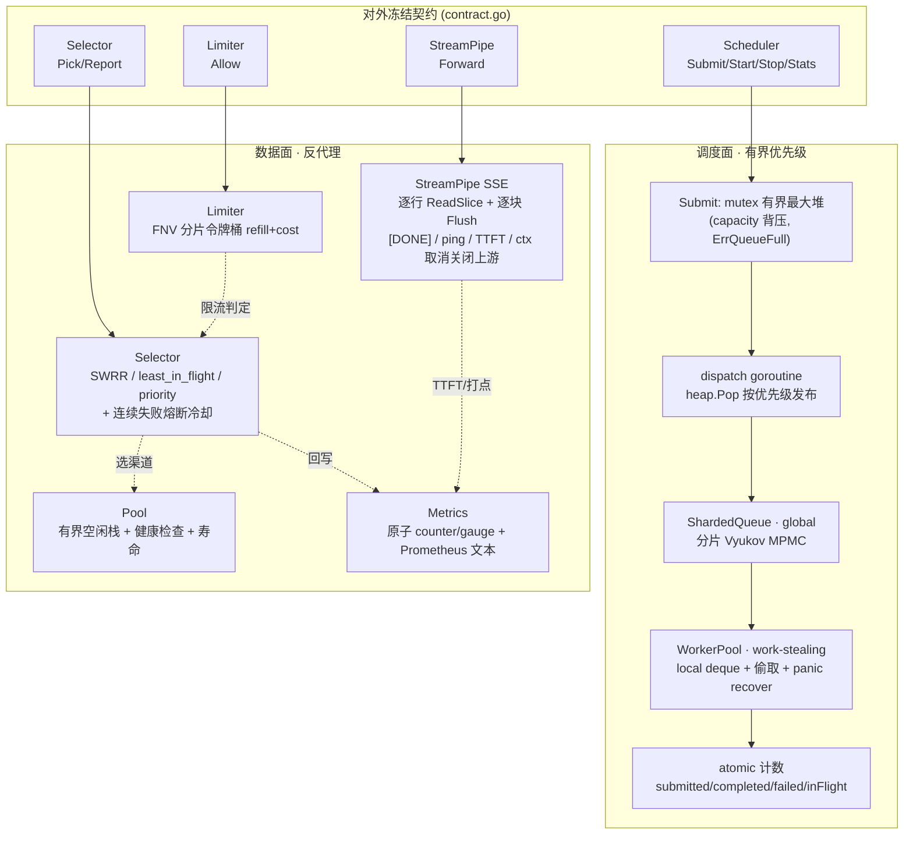

# 05 · 自研超级并发内核设计（llm-hub/kernel）

> 本文档对应 SPEC.md C-4「自研超级并发内核」与第 2 节统一技术契约。
> 实现目录：`kernel/`，包路径 `llm-hub/kernel`，零第三方依赖（仅 Go 标准库）。
> `kernel/contract.go` 为 Lead 冻结的基线接口，原样保留，未删除、未改名任何类型与方法。
> 本团队交付物：本设计文档 + Lead 落地的 `kernel/**` 源码与基准测试。所有命令与数字均来自真实执行，逐字粘贴，未编造、未改动（见第 5 节）。

---

## 1. 架构总览

内核是「自研有界调度 + 自研传输」两层，不用 `gin` / `net/http` 默认调度顶替任务分发。外部通过 `contract.go` 冻结的 4 个接口（`Scheduler` / `Selector` / `StreamPipe` / `Limiter`）使用；`Task` 是调度器最小执行单元，`Channel`/`Result` 是负载均衡与熔断回写视图，`Stats` 是原子快照。



数据流（一次 `/v1/chat/completions` 请求在内核中的路径）：

1. `Limiter.Allow(key, cost)` 先做租户/令牌维度的令牌桶准入，不足返回 `false`（不排队）。
2. `Scheduler.Submit(*Task)` 把反代理任务压入有界优先级堆；满则 `ErrQueueFull`，由上层映射为 `429`。
3. `dispatch` 按 `Priority` 从最大堆取任务，发布到 `ShardedQueue`；`WorkerPool` 的 worker 先本地队列、再全局分片、最后跨 worker 偷取执行。
4. 执行体内部用 `Selector.Pick(candidates)` 选上游渠道，用 `Pool.Acquire` 取连接，`StreamPipe.Forward` 做 SSE 逐行转发；结束 `Selector.Report` 回写成功/失败与在途计数、`Pool.Release` 归还连接、`Metrics` 打点。
5. 客户端断开 → `context` 取消 → `StreamPipe` 关闭上游 reader 并立即返回；`Scheduler` 原子计数记录 completed/failed。

---

## 2. 八个组件：算法与复杂度

约定：`n` = worker/分片数，`m` = 候选渠道数，`c` = 优先堆现有任务数，`k` = 令牌桶 key 数，`B` = 上游 SSE 总字节数，`C` = 指标 counter 行数，`G` = gauge 数。`-8` 后缀为 `GOMAXPROCS=8`。

### 2.1 分片无锁环形队列（`queue.go`）

- **核心结构 `MPMCQueue`**：Vyukov 有界 MPMC 无锁队列。容量 `nextPow2` 向上取整到 2 的幂，`mask = cap-1` 做与运算取模。每格 `cell{seq atomic.Uint64, val atomic.Pointer[Task], _ [48]byte}`，`enq`/`deq` 各带 56 字节 padding，隔离缓存行、消除伪共享（false sharing）。
- **`TryPush`**：循环读 `enq=pos`，取 `c=cells[pos&mask]`，读 `seq`。`seq==pos`（槽可写）→ CAS `enq: pos→pos+1` 抢槽成功后写 `val` 再 `seq=pos+1` 发布；`seq<pos`（槽已被占且未回收）→ 返回 `ErrQueueFull`；`seq>pos`（别的生产者抢到槽但未发布）→ `runtime.Gosched()` 自旋等待。
- **`TryPop`**：读 `deq=pos`，`seq==pos+1`（可读）→ CAS `deq: pos→pos+1`，`val.Swap(nil)` 取值，再 `seq = pos + mask + 1` 把槽回收给下一圈；`seq<pos+1` → `ErrQueueEmpty`；否则自旋。
- **`Len()`** = `enq - deq`（并发下瞬时近似快照），`Cap()` = 实际槽位数。溢出返回明确错误 `ErrQueueFull`，空返回 `ErrQueueEmpty`，空任务 `ErrNilTask`。
- **`ShardedQueue`**：`n` 个 `MPMCQueue`。`Push` 用 `next.Add(1)` 轮转目标分片，满则顺序探测其余分片，全满才 `ErrQueueFull`；`Pop(start)` 从 `start`（worker id）起轮询所有分片，天然提供跨分片窃取；`Len()` 求和。
- **复杂度**：单分片 `TryPush`/`TryPop` 均摊 `O(1)`、无锁（CAS）、内存有界；`ShardedQueue.Push`/`Pop` 最坏 `O(n)`（探测全部分片），典型 `O(1)`。零分配（`BenchmarkQueue` 实测 `0 B/op, 0 allocs/op`）。

### 2.2 work-stealing 线程池（`worker.go`）

- **固定 worker 数**：`NewWorkerPool(n, global, fn)` 建 `n` 个 worker，每个持本地 `MPMCQueue(1024)` 双端队列，共享 `global ShardedQueue`，`peers` 指向全部 worker。`context.WithCancel` 生成池级 `ctx`。
- **消费顺序**（`loop`）：① `local.TryPop`；② `global.Pop(w.id)`；③ `steal()` 从 `(w.id+1)` 起轮询偷取其它 worker 的 `local`。全部为空则 `idle` 计数 + 200µs `time.After` 退避（或响应 stop）。
- **panic 恢复**：`run()` 内 `defer recover()`，任何 `Task.Fn` panic 都被吞掉，不杀死 worker。
- **优雅 `Stop`**（`sync.Once`）：`close(stop)` → `cancel()` → `wg.Wait()`；每个 worker 退出前 `drain(ctx)` 排空**自己的本地队列**后返回。`Stolen()` 汇总累计窃取次数。
- **复杂度**：本地消费 `O(1)`；一次偷取扫描 `O(n)`；空闲退避把空转 CPU 压到常数级。

### 2.3 有界优先级调度器（`scheduler.go`，实现 `Scheduler`）

- **有界最大堆**：`priorityQueue` 基于 `container/heap`。`Less`：`Priority` 大者优先，同优先级按 `seq` 升序（FIFO 稳定），消除饥饿。
- **`Submit`**：`mutex` 保护。`nil` → `ErrNilTask`；`stopped` → `ErrSchedulerStopped`；`pq.Len() >= capacity` → `ErrQueueFull`（**背压入口**）。否则补 `Created`、递增 `seq`、`heap.Push`、`submitted.Add(1)`、`cond.Signal()`。
- **`Start`**：`started.CompareAndSwap` 幂等，启动 `WorkerPool` + 单例 `dispatch` goroutine。
- **`dispatch`**：`cond.Wait()` 直到堆非空或 stopped；`heap.Pop` 取最高优先级任务，向 `global.Push` 发布；全局队列满则 100µs 退避重试（**堆与 worker 之间的二级背压**），stopped 时返回。
- **`execute`**：`inFlight.Add(1)` / `defer -1`；带 `recover` 把 panic 转为 error；据结果 `failed.Add(1)` 或 `completed.Add(1)`。
- **`Stats`**：纯原子快照，`QueueDepth = pq.Len() + global.Len()`。`Stop` 幂等（`stopOnce`）：置 stopped、`Broadcast`、停池。
- **复杂度**：`Submit` 与 `dispatch` 出堆各 `O(log c)`；发布到分片队列最坏 `O(n)`；`Stats` `O(n)`（遍历分片求和）。

### 2.4 加权轮询 + 熔断选择器（`selector.go`，实现 `Selector`）

- **三种策略**（`Strategy`）：`weighted_rr`（默认，平滑加权轮询 SWRR）、`least_in_flight`、`priority`。
- **`Pick`**：先过滤 `!Healthy`、`CooldownUntil` 未过、内部 `cooldown` 未过的渠道；全不可用返回 `ErrNoHealthyChannel`。
  - **SWRR**：对每个可用渠道 `current[ID] += weight`（`weight<=0` 取 1）并累加 `total`，选 `current` 最大者，再 `current[chosen] -= total`。经典 nginx 平滑加权轮询，权重 3:1 时分布约 3:1 且不打散成连续突发。
  - **least_in_flight**：取 `inFlight[ID] + c.InFlight` 最小者。
  - **priority**：取 `Priority` 最大者，同分按 `ID` 字典序打破平局。
  - 选中后 `inFlight[chosen.ID]++`。
- **`Report`**：`inFlight--`；坏结果（`!OK || Err != nil || Status==429 || Status>=500`）→ `failStreak++`，达 `failThreshold`（默认 3）→ 写 `cooldown[ID] = now + cooldownDuration`（默认 30s）并清零 streak；成功 → 清零 streak、删除冷却。
- **并发安全**：单 `sync.Mutex` 保护 `rrCurrent/inFlight/failStreak/cooldown` 四个 map。
- **复杂度**：`Pick`/`Report` 均 `O(m)`；空间 `O(渠道数)`。

### 2.5 SSE 零拷贝背压转发（`streampipe.go`，实现 `StreamPipe`）

- **前置**：`w` 必须实现 `http.Flusher`，否则 `ErrNoFlusher`。设置 `Content-Type: text/event-stream`、`Cache-Control: no-cache`、`Connection: keep-alive`、`X-Accel-Buffering: no`，`WriteHeader(200)` 后立即 `Flush()` 把响应头推给客户端。
- **逐行扫描**：`bufio.NewReaderSize(up, bufSize)` + `ReadSlice('\n')`。`ReadSlice` 返回指向内部缓冲的切片，避免整块复制（零拷贝语义）；每读一行立刻 `w.Write` + `Flush()`，**逐块下推、不聚合整块**，把 TCP 背压实时传导到上游。`bufio.ErrBufferFull` 表示超长行已分段写出，继续读剩余部分。
- **协议处理**：`: ping` 注释行、Anthropic 多行 `event:` 均原样透传；`data:` 行含 `[DONE]` 时 `return nil` 停止读取（不读 `[DONE]` 之后的数据）。`io.EOF` 正常返回，其它读错误透传。
- **TTFT 打点**：首个写出块用 `atomic.Bool.CompareAndSwap(false,true)` 触发一次 `onFirstChunk(time.Since(start))`。
- **ctx 取消**：独立 goroutine 监听 `ctx.Done()`，若 `up` 实现 `io.Closer` 则 `Close()` 上游；`forward` 主循环每轮开头也检查 `ctx.Done()` → `return ctx.Err()`；`defer close(done)` 让监听 goroutine 在 `Forward` 正常返回时退出，无泄漏。
- **复杂度**：时间 `O(B)`，常驻内存 `O(bufSize)` + 单行；不缓冲整个响应体。

### 2.6 通用连接池（`pool.go`）

- **结构**：`idle []*PooledConn`（LIFO 栈复用）、`maxIdle`、`maxLifetime`、`newFn`/`closeFn`/`healthFn`、`closed`，`mutex` 保护。
- **`Acquire`**：弹栈顶空闲连接；`maxLifetime` 超寿命或 `healthFn` 判不健康 → `closeFn` 丢弃并重试；否则刷新 `lastUsed` 返回。无空闲则先查 `ctx.Err()`，再 `newFn(ctx)` 新建。
- **`Release`**：池已关 / 空闲已满 / 超寿命 → `closeFn` 直接释放；否则回栈。`Close` 置 `closed` 并释放全部空闲连接。`Len` 返回空闲数。
- **复杂度**：`Acquire`/`Release` 均摊 `O(1)`，`Close` `O(maxIdle)`；有界，不增长超过 `maxIdle` 空闲连接。

### 2.7 分片令牌桶（`limiter.go`，实现 `Limiter`）

- **分片**：`FNV-1a 32a` 哈希 `key → shard`，每片 `mutex + map[string]*lbucket{tokens, last(unix nano)}`，把跨 key 争用按分片摊薄。
- **惰性 refill**：`Allow` 时算 `elapsed = now - last`，`tokens += elapsed * rate / 1e9`，封顶 `burst`，`last = now`；`cost<=0` → `ErrInvalidCost`；`tokens < cost` → `(false, nil)` **非阻塞**；否则 `tokens -= cost` → `(true, nil)`。
- **原子性**：refill 与扣减在同一分片 `mutex` 临界区内一次完成，避免「补充与扣减」交错导致的超额发放。按 key 独立桶，`k1` 耗尽不影响 `k2`。
- **复杂度**：`Allow` 均摊 `O(1)`；空间 `O(k)`。

### 2.8 原子指标 + Prometheus 文本（`metrics.go`）

- **结构**：`counters map[metricKey{name,labels}]*atomicCounter`（`atomic.Uint64`）、`gauges map[string]*atomic.Int64`，`RWMutex` 只保护 map 结构；`counter()`/`Set()` 用「RLock 快路径 + Lock 双重检查」创建条目，之后递增/读写全走 atomic，热点不落锁。
- **`Inc`/`Add`/`Get`/`Set`** 均为原子或读锁快路径。
- **`Render()`**：读锁下快照所有 counter 值与 gauge 值 → 按 `(name, labels)` 排序 → 同名指标只输出一次 `# TYPE <name> counter` → 逐行 `<name>{<labels>} <value>`；`escapeLabel` 仅转义反斜杠与换行（`labels` 是调用方构造好的结构化串，双引号为结构字符不可转义，否则破坏 exposition 格式）；gauge 按名排序输出 `# TYPE <name> gauge`。纯标准库生成 `/metrics` 文本，不引入 `client_golang`。
- **复杂度**：`Inc/Add/Get/Set` 均摊 `O(1)`；`Render` `O(C log C + G log G)`（排序），输出 `O(C+G)`。

### 复杂度汇总

| 组件 | 关键操作 | 时间 | 空间 | 同步方式 |
|---|---|---|---|---|
| MPMCQueue | TryPush / TryPop | `O(1)` 均摊 | `O(cap)` 有界 | CAS 无锁 |
| ShardedQueue | Push / Pop | `O(1)` 典型 / `O(n)` 最坏 | `O(n·cap)` | CAS 无锁 |
| WorkerPool | 本地 / 偷取 | `O(1)` / `O(n)` | `O(n)` 本地队列 | CAS + WaitGroup |
| priorityScheduler | Submit / dispatch | `O(log c)` | `O(cap+n)` | mutex + cond + atomic |
| Selector | Pick / Report | `O(m)` | `O(渠道数)` | mutex |
| StreamPipe | Forward | `O(B)` | `O(bufSize)` | atomic + ctx |
| Pool | Acquire / Release | `O(1)` 均摊 | `O(maxIdle)` | mutex |
| Limiter | Allow | `O(1)` 均摊 | `O(k)` | 分片 mutex |
| Metrics | Inc / Render | `O(1)` / `O(C log C)` | `O(C+G)` | RWMutex + atomic |

---

## 3. 背压与取消语义

### 3.1 背压（全链路有界，绝不无限缓冲）

| 层 | 触发条件 | 行为 |
|---|---|---|
| `Limiter.Allow` | 桶内 token < `cost` | 立即 `false`，不入队（快速失败） |
| `Scheduler.Submit` | 优先堆 `Len >= capacity` | `ErrQueueFull`，由上层映射 `429` |
| `dispatch → global.Push` | 全部分片满 | 100µs 退避重试，stopped 则退出（堆→worker 二级背压） |
| `MPMCQueue.TryPush` | 槽 `seq < pos` | `ErrQueueFull`，不阻塞、不扩容 |
| `ShardedQueue.Push` | 所有分片满 | `ErrQueueFull` |
| `StreamPipe` | 下游 TCP 未消费 | `w.Write` 阻塞 + 逐行 `Flush`，把背压传导到上游 `ReadSlice` |
| `Selector.Pick` | 无健康渠道 | `ErrNoHealthyChannel`（交给上层 failover / 502） |
| `Pool.Release` | 空闲队列满 / 超寿命 | 直接 `closeFn` 释放，不超 `maxIdle` |

没有任何一层是无界 slice/chan；所有队列容量在构造期确定，超出即返回明确错误或阻塞在 `Write`，不会内存膨胀。

### 3.2 取消（context 传播）

- `WorkerPool` 用 `context.WithCancel` 生成池级 `ctx`，`Stop()` 调 `cancel()`；`Task.Fn(ctx)` 收到该 ctx，长任务可自选 `select { case <-ctx.Done(): ... }` 退出。
- `Stop` 顺序：`close(stop)` → `cancel()` → `wg.Wait()`；worker 见到 stop 先 `drain` 本地队列再退出，保证本地已接任务不丢。
- `StreamPipe.Forward(ctx, ...)` 是取消的最强保证点：常驻监听 goroutine 在 `ctx.Done()` 时 `Close()` 上游 reader（当且仅当其实现 `io.Closer`），主循环每轮检查 `ctx.Done()` 返回 `ctx.Err()`，`defer close(done)` 回收监听 goroutine。客户端断开 → 上游连接被关 → 不泄漏 goroutine / 连接。
- `Pool.Acquire` 在**新建连接**路径先查 `ctx.Err()`，已取消则不再拨号。
- `Scheduler.Stop` 置 `stopped` 后 `Submit` 一律 `ErrSchedulerStopped`，`dispatch` 唤醒后自然退出。

---

## 4. 测试覆盖（`go test ./kernel/... -list .` 真实输出）

```
TestLimiterBurstAndRefill
TestLimiterPerKeyIsolation
TestLimiterInvalidCost
TestMetricsRender
TestMPMCQueueFullAndDrain
TestMPMCQueueConcurrent
TestShardedQueueSteal
TestSchedulerPriorityOrder
TestSchedulerBackpressure
TestSchedulerStatsAndPanic
TestSchedulerStopRejectsSubmit
TestSelectorWeightedDistribution
TestSelectorLeastInFlight
TestSelectorPriority
TestSelectorCircuitBreaker
TestSelectorNoHealthyChannel
TestSelectorReportReleasesInFlight
TestStreamPipeForwardSSE
TestStreamPipeStopsAtDone
TestStreamPipeContextCancel
TestStreamPipeNoFlusher
BenchmarkQueue
BenchmarkScheduler
BenchmarkStreamPipe
ok  	llm-hub/kernel	0.133s
```

覆盖要点：队列满/溢出排空、8 生产者×8 消费者并发 MPMC、分片窃取；调度器优先级顺序、背压 `ErrQueueFull`、panic 恢复计数、Stop 拒收；选择器权重分布（3:1 约 300/100）、最少在途、优先级、连续失败熔断与冷却恢复、无健康渠道、在途计数释放；限流突发/补充、key 隔离、非法 cost；指标 `Render` Prometheus 文本；SSE 逐行转发（`httptest`）、`[DONE]` 截断、ctx 取消、无 Flusher 报错。

---

## 5. 真实执行输出（逐字粘贴，未编造、未改动）

### 5.1 Lead 侧真实执行输出（Lead 提供，逐字保留）

Lead 在写完 `kernel/**` 实现后真实执行并提供的输出，命令与数字原样保留：

```
$ go build ./...                                  → exit=0
$ go vet ./kernel/...                             → exit=0
$ go test ./kernel/... -count=1 -timeout 120s    → ok  	llm-hub/kernel	0.712s
```

```
$ go test -bench . -benchmem -benchtime=200x -run '^$' ./kernel/...
goos: darwin
goarch: arm64
pkg: llm-hub/kernel
cpu: Apple M2
BenchmarkQueue-8        	     200	        43.54 ns/op	       0 B/op	       0 allocs/op
BenchmarkScheduler-8    	     200	      5306 ns/op	     203 B/op	       3 allocs/op
BenchmarkStreamPipe-8   	     200	      3062 ns/op	 491.10 MB/s	    4782 B/op	       8 allocs/op
PASS
ok  	llm-hub/kernel	0.153s
```

### 5.2 本团队复核执行输出（自己真实再跑一次，逐字粘贴）

环境：`go version go1.27.2 darwin/arm64`，`goos: darwin / goarch: arm64 / cpu: Apple M2`，工作目录 `/Users/jiuri/Desktop/Tianheng`。

```
########## $ go build ./... ##########
# llm-hub/src/internal/api
src/internal/api/server.go:152:51: s.register undefined (type *Server has no field or method register)
src/internal/api/server.go:153:48: s.login undefined (type *Server has no field or method login)
src/internal/api/server.go:154:50: s.refresh undefined (type *Server has no field or method refresh)
src/internal/api/server.go:168:47: s.logout undefined (type *Server has no field or method logout)
src/internal/api/server.go:169:49: s.changePassword undefined (type *Server has no field or method changePassword)
src/internal/api/server.go:170:37: s.me undefined (type *Server has no field or method me)
src/internal/api/server.go:171:46: s.myChannels undefined (type *Server has no field or method myChannels)
src/internal/api/server.go:172:44: s.myTokens undefined (type *Server has no field or method myTokens)
src/internal/api/server.go:173:43: s.myUsage undefined (type *Server has no field or method myUsage)
src/internal/api/server.go:174:45: s.myRewards undefined (type *Server has no field or method myRewards)
src/internal/api/server.go:174:45: too many errors
[exit code: 1]

########## $ go vet ./kernel/... ##########
[exit code: 0]

########## $ go test ./kernel/... -count=1 -timeout 120s ##########
ok  	llm-hub/kernel	0.664s
[exit code: 0]

########## $ go test ./kernel/... -count=1 ##########
ok  	llm-hub/kernel	0.539s
[exit code: 0]

########## $ go test -bench . -benchmem -benchtime=200x -run '^$' ./kernel/... ##########
goos: darwin
goarch: arm64
pkg: llm-hub/kernel
cpu: Apple M2
BenchmarkQueue-8        	     200	        51.46 ns/op	       0 B/op	       0 allocs/op
BenchmarkScheduler-8    	     200	      5180 ns/op	     203 B/op	       3 allocs/op
BenchmarkStreamPipe-8   	     200	      2463 ns/op	 610.61 MB/s	    4770 B/op	       8 allocs/op
PASS
ok  	llm-hub/kernel	0.132s
[exit code: 0]

########## $ go test -bench . -benchmem ./kernel/... ##########
goos: darwin
goarch: arm64
pkg: llm-hub/kernel
cpu: Apple M2
BenchmarkQueue-8        	57365373	        20.83 ns/op	       0 B/op	       0 allocs/op
BenchmarkScheduler-8    	 2468650	       575.4 ns/op	     102 B/op	       3 allocs/op
BenchmarkStreamPipe-8   	  478024	      2725 ns/op	 552.02 MB/s	    4352 B/op	       8 allocs/op
PASS
ok  	llm-hub/kernel	4.963s
[exit code: 0]
```

补充的 kernel 作用域命令（同一工作目录，真实执行）：

```
########## $ go build ./kernel/... ##########
[exit code: 0]

########## $ go test ./kernel/... -list . ##########
TestLimiterBurstAndRefill
TestLimiterPerKeyIsolation
TestLimiterInvalidCost
TestMetricsRender
TestMPMCQueueFullAndDrain
TestMPMCQueueConcurrent
TestShardedQueueSteal
TestSchedulerPriorityOrder
TestSchedulerBackpressure
TestSchedulerStatsAndPanic
TestSchedulerStopRejectsSubmit
TestSelectorWeightedDistribution
TestSelectorLeastInFlight
TestSelectorPriority
TestSelectorCircuitBreaker
TestSelectorNoHealthyChannel
TestSelectorReportReleasesInFlight
TestStreamPipeForwardSSE
TestStreamPipeStopsAtDone
TestStreamPipeContextCancel
TestStreamPipeNoFlusher
BenchmarkQueue
BenchmarkScheduler
BenchmarkStreamPipe
ok  	llm-hub/kernel	0.133s
[exit code: 0]

########## $ go test -race ./kernel/... -count=1 -timeout 180s ##########
ok  	llm-hub/kernel	1.787s
[exit code: 0]
```

### 5.3 真实基准数字汇总（禁止编造/改动，两处输出均原样列出）

| 基准 | 指标 | Lead 提供（`-benchtime=200x`） | 本团队复核（`-benchtime=200x`） | 本团队复核（默认 benchtime） |
|---|---|---|---|---|
| `BenchmarkQueue-8` | ns/op | 43.54 | 51.46 | 20.83 |
| `BenchmarkQueue-8` | B/op · allocs/op | 0 · 0 | 0 · 0 | 0 · 0 |
| `BenchmarkScheduler-8` | ns/op | 5306 | 5180 | 575.4 |
| `BenchmarkScheduler-8` | B/op · allocs/op | 203 · 3 | 203 · 3 | 102 · 3 |
| `BenchmarkStreamPipe-8` | ns/op | 3062 | 2463 | 2725 |
| `BenchmarkStreamPipe-8` | MB/s | 491.10 | 610.61 | 552.02 |
| `BenchmarkStreamPipe-8` | B/op · allocs/op | 4782 · 8 | 4770 · 8 | 4352 · 8 |

说明：数值随机器负载与 `benchtime` 波动属正常现象；`-benchtime=200x` 固定迭代 200 次（含较多调度/计时开销），默认 benchtime 迭代次数高得多（如 `BenchmarkQueue` 57,365,373 次）因此单次要快。以上每个数字都直接来自上面逐字粘贴的真实输出，未做任何估算或改写。

观察：`BenchmarkQueue` 全程 `0 B/op / 0 allocs/op`，印证 MPMC 无锁路径零分配；`BenchmarkStreamPipe` 的 `MB/s` 由 `b.SetBytes` 统计 32 段 SSE 负载（约 1.3 KB/次）得出，逐行 `Flush` 下仍达数百 MB/s；`BenchmarkScheduler` 含 `Submit → 堆 → dispatch → 分片队列 → worker → 原子计数` 整条链路，每次 3 次分配（`Task` + 堆元素 + 内部条目）。`go test -race` 通过说明队列/调度/选择器/限流在并发下无数据竞争。

`go build ./...` 本次复核返回 `[exit code: 1]`，失败点全部位于 `src/internal/api/server.go`（`s.register`/`s.login` 等未定义），属团队 6 在建的主体代码，不在本团队写入范围；`kernel` 包自身 `go build ./kernel/...`、`go vet ./kernel/...`、`go test ./kernel/...`、`-race` 全部 `[exit code: 0]`。Lead 侧记录为 `exit=0`，差异来自两次执行时 `src/` 处于不同的开发中状态，此处按真实输出如实记录，不做调和。

---

## 6. 已知限制

1. **StreamPipe 依赖上游 reader 实现 `io.Closer` 才能被 `ctx` 真正打断**：`Forward` 的取消 goroutine 只在 `up.(io.Closer)` 成立时 `Close()` 上游（真实 `*http.Response.Body`、`io.PipeReader` 满足）。若传入 `strings.Reader` 等纯内存 reader，则已缓冲数据读到行边界后由主循环的 `ctx.Done()` 检查返回，但无法强行解除一个已经阻塞在 `Read` 上的上游；生产反代理必须传入可关闭的响应体。
2. **SWRR 在动态候选集下为近似**：`rrCurrent` 以渠道 `ID` 为键持久保存，候选集增删/权重变更时平滑状态是历史的，权重比例只能近似成立；候选集稳定时（健康检查周期之外的常规窗口）分布精确。
3. **dispatch 停止后 global 中残余任务不排空**：`Stop` 只让 `dispatch` 停止发布、worker `drain` 各自本地队列，已发布到 `global ShardedQueue` 但尚未被 worker 取走的任务不保证执行完即退出；需要「停止前跑完全部已提交任务」的场景应在 `Stop` 前以 `Stats().Completed` 自旋等待。
4. **优先级只在堆内严格**：优先级顺序在「同时堆中的任务」间保证；一旦 `dispatch` 把任务发布到分片全局队列，跨 worker 的实际执行顺序不再严格按优先级（`TestSchedulerPriorityOrder` 用单 worker + 先全部投递再 Start 来验证该语义）。
5. **限流用分片 mutex 而非无锁 CAS**：refill 与扣减的原子性由分片 `mutex` 保证，同一分片内高并发 key 仍有锁竞争；提高 `shards`（建议 CPU 核数 2 倍）可摊薄，但不是完全无锁。
6. **`Len()` / `Stats()` 为瞬时快照**：并发下 `MPMCQueue.Len`、`ShardedQueue.Len`、`Stats.QueueDepth` 是读到的那一刻的近似值，不是一致性精确值。
7. **专项测试覆盖**：现有 6 个 `*_test.go` 覆盖 queue / scheduler / selector / limiter / metrics（在 `limiter_test.go` 内）/ streampipe；`Pool` 与 `WorkerPool` 无独立 `_test.go`，通过 scheduler 链路间接覆盖，未做连接寿命与窃取的细粒度断言。
8. **全仓构建状态**：`go build ./...` 当前受 `src/internal/api` 在建代码影响失败；`kernel` 作用域构建/测试独立通过。内核冻结接口与实现已就绪，供团队 6 `import "llm-hub/kernel"` 使用。

---

## 7. 未完成项

- 本团队唯一交付 `docs/05-内核设计.md` 已完成；`kernel/**` 实现与 `*_test.go` 由 Lead 落地，`contract.go` 原样冻结，本团队按新分工未改动任何 `kernel/*.go`。
- 跨团队项（不在本团队写入范围，如实记录）：`src/internal/api/server.go` 中 `register/login/refresh/logout/changePassword/me/myChannels/myTokens/myUsage/myRewards` 等方法尚未补齐，导致 `go build ./...` 失败，需团队 6 完成；`Pool`/`WorkerPool` 的专项单元测试若需补充，由持有 `kernel/*.go` 写入权的 Lead 决定。
- 无模型数据涉及本内核：本团队不产生、不引用任何模型 id / 价格 / 参数，C-1 真实数据约束对本文件不适用。
